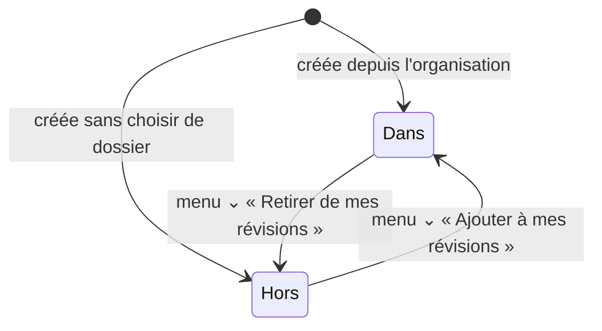

# darwin — spécification fonctionnelle

> **Ce document est la référence de la logique de l'appli.** Il décrit ce
> que fait darwin, sans code. On le tient à jour à chaque changement.
>
> - **Vous** (propriétaire) : écrivez vos demandes dans la rubrique
>   [Demandes](#9-demandes), avec vos mots. Vous pouvez aussi modifier
>   directement n'importe quelle règle : la modification vaut demande.
> - **Claude** : lit ce document avant chaque modification de l'appli,
>   signale toute contradiction avant de coder, puis met à jour les règles,
>   les écrans et le [journal des changements](#10-journal-des-changements)
>   dans la même branche que le code.
>
> Si l'appli et ce document ne disent pas la même chose, c'est soit un
> bug, soit une décision à prendre (rubrique [Questions
> ouvertes](#8-questions-ouvertes)).

**Version de l'appli décrite : v253** — première rédaction le 2 novembre 2026,
à partir du code.

## Sommaire

1. [Vue d'ensemble](#1-vue-densemble)
2. [Les concepts](#2-les-concepts)
3. [Comptes et usages](#3-comptes-et-usages)
4. [L'algorithme de révision](#4-lalgorithme-de-révision)
5. [Boîtes, dossiers et organisation](#5-boîtes-dossiers-et-organisation)
6. [Classes](#6-classes)
7. [Librairie et abonnements](#7-librairie-et-abonnements)
8. [Questions ouvertes](#8-questions-ouvertes)
9. [Demandes](#9-demandes)
10. [Journal des changements](#10-journal-des-changements)
11. [Annexe : les écrans](#11-annexe--les-écrans)
12. [Annexe : réglages de Darwin Admin](#12-annexe--réglages-de-darwin-admin)

---

## 1. Vue d'ensemble

**darwin** est une appli de révision par fiches question / réponse. Elle
décide elle-même **quand** reposer chaque fiche, selon les réponses
données et les échéances (contrôles, examens) notées dans l'agenda.

| Pour qui | Ce qu'il fait |
|---|---|
| **Élève** | Crée ses boîtes de fiches, révise, prend des boîtes dans la Librairie, rejoint les classes de ses enseignants. |
| **Enseignant** | Crée des classes, y partage des boîtes et des échéances, échange avec ses élèves. |
| **Administrateur** (darwin) | Règle l'appli depuis **Darwin Admin**, gère la Librairie, les abonnements, les établissements. |

L'appli s'installe sur un téléphone ou un ordinateur depuis le navigateur.
Elle fonctionne **hors connexion** : les changements partent vers le
serveur dès que le réseau revient. Une connexion à un compte est
**obligatoire** pour l'utiliser.

---

## 2. Les concepts

| Mot | Définition |
|---|---|
| **Compte** | Une adresse email + mot de passe. Toutes les données personnelles (boîtes, fiches, progression, agenda) appartiennent au compte et se retrouvent sur tous ses appareils. |
| **Usage** | « Élève » et/ou « Enseignant », choisis dans Mon compte. |
| **Compte élève / compte enseignant** | L'environnement utilisé, quand le compte a les deux usages (voir §3.2). |
| **Fiche** | Une question, une réponse ; en option : un complément (« en savoir plus »), 3 réponses fausses (mode QCM), un lien « Pour aller plus loin ». |
| **Boîte** | Un ensemble de fiches. Trois types, voir §5.1 : **à moi**, **de classe**, **de la Librairie**. |
| **Dossier** | Range des boîtes et d'autres dossiers, dans l'organisation. |
| **Dans / hors de mes révisions** | État d'une boîte : l'algorithme s'applique à ses fiches, ou non (la progression est gardée). Voir §5.2. |
| **Échéance (évènement)** | Une date dans l'agenda (contrôle, examen…), reliée à des boîtes. Elle fait passer ces boîtes en **mode sprint** (§4.3). |
| **Classe** | Un groupe créé par un enseignant, rejoint par des élèves avec un code. |
| **Librairie** | Le catalogue de boîtes publiées, accessible avec un abonnement (ou quelques boîtes gratuites). |
| **Collection** | Une boîte publiée dans la Librairie (c'est le mot utilisé dans le code). |
| **Signalement** | Un message envoyé à l'auteur d'une fiche pour lui signaler une erreur. |

---

## 3. Comptes et usages

### 3.1 Création du compte et connexion

À l'inscription, on donne : email, mot de passe, prénom, nom, date de
naissance, usages (élève et/ou enseignant, au moins un), niveau scolaire
(facultatif), et on accepte les conditions d'utilisation et la politique
de confidentialité.

La page est présentée en blocs, sans titre (v262) : prénom, nom, date de
naissance ; email, mot de passe ; « Utilisation de l'appli » ; niveau
scolaire. L'usage élève s'appelle « en utilisateur normal — pour un usage
personnel ou pour rejoindre les classes de tes enseignants » et il est
**coché par défaut**.

**Présentation commune (v262)** : un seul aspect pour toute l'appli —
- boutons principaux d'une seule couleur (celle du logo darwin) ;
  « Annuler », « Retour »… en gris ; « Supprimer » en rouge ;
- zones de saisie et textes d'exemple : même police, même taille, même
  gris pour l'exemple ;
- classement (catégorie → cycle → niveau…) : blocs emboîtés comme dans
  la Librairie, partout (création du compte, Mon compte, création ou
  classement d'une boîte, publication).

- **Connexion obligatoire** : sans compte connecté, seule la page Mon
  compte est accessible.
- **Mot de passe oublié** : un email permet d'en choisir un nouveau.
- **Moins de 15 ans** : l'email d'un parent est demandé ; le parent reçoit
  un email pour donner son accord. En attendant, le compte est
  **limité** : on peut créer ses fiches et réviser, mais pas :
  rejoindre ou créer une classe, écrire dans une messagerie, signaler une
  fiche à son auteur, s'abonner, gérer un établissement. La limite se lève
  à l'accord du parent, ou automatiquement le jour des 15 ans.
- **Suppression du compte** (Mon compte) : tout est effacé définitivement
  (boîtes, fiches, progression, agenda, messages, boîtes publiées, classes
  de l'enseignant).

### 3.2 Compte élève / compte enseignant

| Usages cochés | À l'ouverture de l'appli | Environnement |
|---|---|---|
| Élève seulement | Accueil | Élève |
| Enseignant seulement | Accueil | Enseignant |
| Les deux | Page « Avec quel compte veux-tu continuer ? » (deux boutons ronds), puis accueil | Celui choisi |
| Aucun (anciens comptes « usage personnel ») | Accueil, avec un bandeau qui demande de choisir | Élève |

- Le choix entre les deux comptes est proposé **à chaque ouverture** de
  l'appli ; le dernier choix est mémorisé sur l'appareil.
- **Repère visuel** (seulement avec les deux usages) : pastille
  « ÉLÈVE » (bleu) ou « ENSEIGNANT » (vert, v261 ; orange avant) dans la
  barre du haut, et un dégradé de la même couleur en haut de l'écran, qui
  s'efface vers le bas (v264 : sans trait).
- **Robot aux couleurs du compte** (v264) : en compte enseignant, ce qui
  est bleu sur le robot (écran, yeux, réacteur, reflets) passe en vert, et
  la petite diode de la caméra passe en bleu.
- **Changer de compte** : toucher la pastille, **sur l'accueil
  uniquement**. Ailleurs, un message rappelle de passer par l'accueil.

**Ce qui change selon le compte utilisé (v250) :**

| | Compte élève | Compte enseignant |
|---|---|---|
| Bouton d'accueil « Mes classes » | Classes rejointes ; « Rejoindre une classe » s'il n'y en a aucune | Classes créées ; « Créer une classe » s'il n'y en a aucune |
| Organisation des boîtes | Dossier « Mes classes » en tête : boîtes des classes rejointes | Dossier « Mes classes » en tête : classes animées et leurs boîtes partagées |
| Autres dossiers et boîtes | Communs aux deux comptes | Communs aux deux comptes |
| Révisions (v256) | Oui | **Non** : bouton « Réviser » grisé (un message explique de passer au compte élève), sans ses pastilles |
| Dans / hors de mes révisions (v256) | Pictos, affichage grisé, menu « Retirer de / Ajouter à mes révisions » | Rien de tout cela |
| Progression (v256) | Jauge « Ma progression » sur la page d'une boîte, affichage en jauge dans l'organisation | Pas de jauge |
| Nouvelle boîte (v256) | Rangée dans un dossier, elle entre dans mes révisions | Rangée dans un dossier, elle reste **hors** de mes révisions (on pourra l'y ajouter depuis le compte élève) |
| Mon agenda (v256) | Évènements créés dans le compte élève + échéances reçues des classes suivies | Évènements créés dans le compte enseignant + échéances données à ses classes |
| Librairie : bouton d'une boîte (v257) | « Ajouter à mes révisions » / « Retirer de mes révisions » | « Ajouter aux révisions » / « Retirer des révisions » (celles du compte élève) |
| Publier une boîte dans la Librairie (v275) | **Non** : ni bouton « Publier dans la Librairie » (le bloc de la page d'une boîte s'appelle alors « Classification »), ni filtres « mes boîtes publiées / non publiées » dans l'organisation, ni « Mes boîtes publiées » dans la Librairie | Oui |
| Librairie (le reste), fiches, statistiques, défi du jour | Identiques | Identiques |

---

## 4. L'algorithme de révision

> L'algorithme (« v2 », validé le 7 octobre) compte en **minutes** et
> tient compte des échéances de l'agenda.
>
> ✅ **Vérifié par des tests automatiques** (v252) : chaque règle de cette
> section a son test, lancé par GitHub à chaque modification du code. Si
> une règle change ici, son test change avec elle.

### 4.1 Les 4 réponses

Après avoir vu la réponse, on note la fiche :

| Bouton | Note | Sens |
|---|---|---|
| Je ne sais pas | 0 | Raté |
| Vague idée | 1 | Partiellement su |
| Je sais | 2 | Su |
| Parfaitement | 3 | Su sans effort |

Sous chaque bouton, l'appli affiche dans combien de temps la fiche
reviendra si on choisit cette note.

Chaque fiche retient : sa **dernière note**, la date de sa **dernière
interrogation**, son **dernier délai** (DD) et sa **prochaine date**.

### 4.2 Mode « fond » (pas d'échéance à venir)

Le nouveau délai se calcule ainsi :

> **nouveau délai = (DD − TE) + TE × coefficient**, puis ramené entre un
> **plancher** et un **plafond**.
>
> DD = dernier délai appliqué ; TE = temps écoulé depuis la dernière
> interrogation.

Autrement dit : si on se souvient bien après longtemps, le délai grandit
d'autant plus.

**Valeurs par défaut** (réglables dans Darwin Admin) :

| Note | Coefficient | Plancher | Plafond | En pratique |
|---|---|---|---|---|
| 0 — Je ne sais pas | 0 | 3 jours | 3 jours | toujours **3 jours** |
| 1 — Vague idée | 0 | 1 jour | 1 jour | toujours **1 jour** |
| 2 — Je sais | 2 | 3 jours | 30 jours | entre 3 et 30 jours |
| 3 — Parfaitement | 3 | 5 jours | 120 jours | entre 5 et 120 jours |

**Choix assumé (décision Q1) :** « Je ne sais pas » repousse plus loin que
« Vague idée ». Quand on commence à avoir une vague idée, ça vaut le coup
de renforcer tout de suite ; une fiche pas du tout sue peut attendre tant
qu'il n'y a pas d'échéance (et elle revient quand même deux fois dans la
séance en cours). Cela évite d'avoir trop de fiches à revoir chaque jour.

### 4.3 Mode « sprint » (échéance à venir)

Une boîte passe en sprint dès qu'une **échéance à venir** de l'agenda la
concerne (directement, ou via un dossier relié à l'échéance). Seules
comptent les échéances du **compte élève** (v256) : une échéance qu'un
enseignant donne à sa classe ne met pas ses propres boîtes en sprint.

- Au passage en sprint, toutes ses fiches deviennent **à revoir tout de
  suite**, et l'appli mémorise leur délai d'avant.
- Pendant le sprint, le délai est le plus court entre :
  - le délai du mode fond ;
  - **D − D / coefficient sprint**, où D = temps restant jusqu'à **8 h le
    jour de l'échéance** la plus proche.
- **Le jour même** de l'échéance : 30 minutes.
- Coefficients sprint par défaut : 1,03 / 1,05 / 2 / 3 (notes 0 à 3).
  Plus le coefficient est grand, plus la fiche revient tard avant
  l'échéance.
- **Une nouvelle échéance plus proche** remet les fiches à revoir tout de
  suite.
- **Fin du sprint** (plus aucune échéance à venir) : retour au mode fond.
  Prochaine interrogation = lendemain de la dernière échéance + le délai
  d'avant le sprint (ou, à défaut, le plancher de la dernière note).

### 4.4 La séance de révision

Une séance continue tant qu'on répond. Ordre de passage :

1. les fiches **dues** (la plus en retard d'abord) ;
2. les fiches notées 0 ou 1 **pendant la séance**, jusqu'à ce qu'elles
   aient été revues deux fois ;
3. toutes les autres, par date prévue (on révise alors « en avance »).

- **Au moins 10 autres fiches** entre deux passages d'une même fiche (ou
  toutes les autres, s'il y en a moins).
- Quand les fiches dues sont vues et les fiches ratées revues deux fois,
  le robot **propose la boîte suivante** des révisions conseillées (sauf
  en « Révisions prioritaires »).
- **Annuler** la dernière note est possible juste après.
- **Évaluation** (v272) : tant que la réponse n'a pas été vue, le texte
  « Cherche la réponse, tourne la fiche, puis évalue-toi » remplace les
  quatre boutons. Quand la fiche se retourne, le texte s'efface et les
  boutons apparaissent l'un après l'autre ; à la fiche suivante, les
  boutons s'effacent et le texte revient. En mode jour, les smileys des
  notes « claires » sont un peu foncés pour rester lisibles (même teinte ;
  les jauges et graphiques gardent leurs couleurs) ; en mode nuit, rien ne
  change.
- Quand les fiches dues sont toutes vues et qu'il reste des fiches ratées
  à revoir, le bas de l'écran passe de « N fiches à revoir » à « On revoit
  les fiches difficiles » ; le robot l'explique alors par un message (une
  fois par séance, v271).
- **Fiche QCM** : si elle a 3 réponses fausses, elle se présente en QCM.
  Une fiche QCM repassée en mode normal puis ratée repasse en QCM.
  Quand la fiche a un complément de réponse (suite de la réponse, « en
  savoir plus » ou lien), il s'affiche une fois la bonne réponse trouvée,
  et la fiche **reste affichée** avec un bouton « Continuer », même quand
  on a répondu juste du premier coup (v271). Sans complément, la fiche
  passe seule à la suivante après une bonne réponse.

### 4.5 Où se révise-t-on ? (page « Réviser »)

| Entrée | Ce qui est révisé |
|---|---|
| **Révisions prioritaires** | Les boîtes reliées aux échéances à venir, échéance la plus proche d'abord. On peut décocher des boîtes. |
| **Renforcer mes connaissances** | Les boîtes **sans** échéance, triées par **retard moyen** (le plus en retard d'abord). |
| **Sélection manuelle** | Une boîte, un dossier, ou une sélection de boîtes, au choix. |

Seules les boîtes **dans mes révisions** (§5.2) et **non verrouillées**
(§7.3) sont concernées, et seules les échéances du compte élève (§4.3).
Les pastilles du bouton « Réviser » de l'accueil comptent les échéances
proches qui ont des fiches à revoir et les boîtes à renforcer. Les
révisions n'existent pas dans le compte enseignant (§3.2).

**Présentation de la page (« mixte », v268-v269, seule présentation depuis
la v277, décision Q11).** La page à trois boutons, avec en plus un bouton
« Comment ça marche ? ». Ce bouton lance une animation en
trois temps (v270) : le texte des ronds s'efface et leur picto grandit
jusqu'à remplir le rond ; puis chaque grand rond glisse lentement vers la
gauche en rapetissant, jusqu'au petit rond de son cadre ; enfin les trois
cadres apparaissent l'un après l'autre. Les cadres s'affichent **repliés**
(titre et notion en une ligne : « Apprentissage rapide pour le jour J »,
« Apprentissage de fond, sur la durée », « Ce que je veux, quand je
veux »), pour tout voir sur un seul écran ; sous le titre, le début du
texte apparaît déjà et s'efface en dégradé, pour montrer qu'il y a une
suite (v271) ; le triangle en bas de chaque cadre, ou un toucher sur cet
aperçu, le déplie ; il se replie avec la même animation, à l'envers
(v272). Les schémas sont alignés à droite au-dessus de chaque cadre (v272).
Sur la page à trois ronds, chaque rond a un contour de la couleur de son
cadre (v271). Chaque cadre a sa couleur, son schéma, son petit rond et
son bouton :
- **« Ici, le plus urgent ! »** (orange, des bonds qui se resserrent
  entre un chronomètre et le calendrier de l'échéance ; dessins du
  propriétaire, v271) : le sprint avant les échéances ; d'où
  viennent les échéances (son agenda, celles des enseignants des classes
  rejointes) ; la prochaine échéance ou « aucune échéance prévue » ; bouton
  « Réviser pour mes échéances » ou « Ajouter une échéance » ;
- **« Là, le travail de fond… »** (vert, des bonds de plus en plus longs) :
  la consolidation, la courbe de l'oubli, le QCM puis l'auto-évaluation, et
  ce que devient la fiche après chacune des quatre réponses ; bouton
  « Renforcer mes connaissances » ;
- **« Révisions libres »** (bleu, des cases cochées au choix) : bouton « Choisir ».
« OK » ramène aux trois ronds (même animation à l'envers). Les cadres
sont de nouveau repliés à chaque ouverture.
Les autres présentations essayées (la page à trois boutons seule, le
« parcours guidé » de la v267) et les liens « Autres présentations » ont
été supprimés en v277 (Q11).

### 4.6 La jauge de progression

Barre à 4 couleurs (du gris au vert) : part des fiches de la boîte (ou du
dossier) selon leur **dernière note** (jamais notée = 0).

---

## 5. Boîtes, dossiers et organisation

### 5.1 Les types de boîtes

| Type | D'où elle vient | Picto | Fiches modifiables ? |
|---|---|---|---|
| **À moi** | Créée par l'utilisateur | Boîte avec un crayon | Oui |
| **De classe** | Partagée par un enseignant d'une classe rejointe | Pile de feuilles | Non (copie en lecture seule, mise à jour en direct quand l'enseignant la modifie) |
| **De la Librairie** | Prise dans la Librairie | Picto « partage » | Non (copie mise à jour depuis la Librairie). Une fiche erronée se **signale** à l'auteur. Un administrateur peut la corriger pour tous. |

Pictos des dossiers : dossier classique ; dossier de classe : deux
personnages.

### 5.2 Dans / hors de mes révisions

| | Dans mes révisions | Hors de mes révisions |
|---|---|---|
| L'algorithme s'applique | Oui | Non (progression gardée) |
| Proposée dans Réviser, Révisions prioritaires, Renforcer | Oui | Non |
| Visible dans l'organisation | Oui, picto flèches en cercle **vertes** | Oui, picto flèches **barrées grises** (ou grisée, selon l'affichage choisi) |

Cas particuliers :

- **Boîte de classe** : toujours dans mes révisions, pas de choix.
- **Boîte de la Librairie prise avec l'offre gratuite** : la retirer
  **libère** une place gratuite mais **efface sa progression** (la boîte
  disparaît).
- **Boîte de la Librairie** : la remettre dans mes révisions demande un
  accès à la Librairie (abonnement ou place gratuite).

### 5.3 L'organisation des boîtes (page « Organisation de mes boîtes de fiches »)

C'est la page centrale : **toutes** les boîtes de l'utilisateur y sont, à
leur place dans l'arborescence.

- **En tête : « Mes classes »**, rangé automatiquement, non modifiable :
  - compte élève : les classes rejointes et leurs boîtes ;
  - compte enseignant : les classes animées et l'arborescence de leurs
    boîtes partagées (lecture seule ; toucher une boîte ouvre la boîte
    d'origine de l'enseignant).
- Puis les dossiers et boîtes de l'utilisateur, par ordre alphabétique.
- **En haut** (v264) : deux boutons ronds, « + Nouvelle boîte » et
  « Librairie » (même bouton que sur l'accueil, même effet). Dessous, le
  champ **« Rechercher une boîte… »** (par nom, sans tenir compte des
  accents ; résultats en liste), puis la barre d'outils. Quand la liste
  défile, la recherche et la barre d'outils restent en haut ; les deux
  boutons ronds passent sous le bandeau.
- **Barre d'outils** : « + Nouveau dossier » ; trois filtres
  **exclusifs** (un seul à la fois, aucun par défaut, enlevés à chaque
  retour sur la page ; re-toucher le filtre actif l'enlève), qui grisent
  ce qui n'est pas concerné :
  - « Afficher les boîtes activées pour la révision » (compte élève) ;
  - « Afficher mes boîtes publiées » (compte enseignant, v275) ;
  - « Afficher mes boîtes non publiées » (compte enseignant, v275).
  Quand on active un filtre, le robot rappelle en une phrase ce qu'il
  montre (« Affichage de mes boîtes publiées dans la Librairie »…) (utile sur téléphone, sans texte au survol). Sa bulle reste
  affichée jusqu'à ce qu'on la ferme (croix ou toucher sur la bulle), même
  si l'on touche ailleurs (v272).
  Pour les deux derniers, les boîtes qui ne sont pas les miennes (classe,
  Librairie) sont toujours grisées ; un dossier reste normal s'il contient
  au moins une boîte concernée. Enfin, nombre de fiches ou jauge à droite
  de chaque ligne.
- **Menu ⌄ d'une ligne** :

| Action | Dossier | Boîte à moi | Boîte de la Librairie | Boîte de classe | Dossier de classe |
|---|---|---|---|---|---|
| Renommer | ✅ | ✅ | ✅ | ❌ | ❌ |
| Déplacer | ✅ | ✅ | ✅ | ❌ | ❌ |
| Retirer de / Ajouter à mes révisions | — | ✅ | ✅ | ❌ | — |
| Supprimer | ✅ (s'il est vide) | ❌ (depuis la page de la boîte) | — | ❌ | ❌ |

- **Toucher une boîte** ouvre sa page (§5.4). Toucher un dossier le
  déplie ou le replie.
- **Créer une boîte** : nom + classification (catégorie → … → matière),
  puis choix du dossier ; elle entre dans mes révisions. Annuler le choix
  du dossier la laisse à la racine, hors de mes révisions.

### 5.4 La page d'une boîte

**Boîte à moi** :

1. Titre : picto + nom de la boîte.
2. Bouton rond « + Ajouter une fiche ».
3. **Ma progression** (jauge) + bouton « Réviser » si la boîte est dans
   mes révisions.
4. **Pour aller plus loin** : lien vers un contenu externe (vidéo,
   cours…) + « Ajouter un lien » / « Modifier ».
5. Bloc **Fiches** (replié : nombre de fiches ; déplié : recherche par
   mot-clé, filtre des fiches signalées 🚩, liste des fiches avec leur
   menu ⌄ : éditer, déplacer, supprimer).
6. Bloc **Librairie** : « Publiée » / « Non publiée », puis la
   classification ou « Classification à définir ». Un seul bouton :
   **Classifier** → **Publier dans la Librairie** → **Voir dans la
   Librairie**. En compte élève (v275), le bloc s'appelle
   **« Classification »** : ni « Publiée / Non publiée », ni « Publier »
   (seulement « Classifier »), sauf pour une boîte déjà publiée
   autrefois (« Voir dans la Librairie »). Tant que la boîte n'est pas publiée, un lien
   **« Modifier »** à côté de la classification permet de la changer
   (une fois publiée, c'est la classification de la publication qui
   compte).
7. Bouton « Supprimer la boîte » (définitif, avec ses fiches).

**Boîte de classe ou de la Librairie** : titre + picto, Ma progression
(+ Réviser), Pour aller plus loin (s'il y a un lien), bloc Fiches.

### 5.5 Mes créations (supprimée en v254)

Cette page n'existe plus : tout ce qu'elle faisait se fait depuis
l'organisation (créer une boîte, la retrouver, filtre Publiées / Non
publiées) et la page de la boîte (publication, classification,
suppression). Abandonné avec elle : la recherche de ses boîtes par
classification et par tags (voir §8, Q5).

### 5.6 Les fiches

- **Créer** : depuis une boîte (« + Ajouter une fiche ») — la fiche va
  dans cette boîte — ou depuis l'accueil, en choisissant la boîte.
- Après « Ajouter à la boîte », on reste sur la page pour enchaîner.
- **Éditer / déplacer / supprimer** : menu ⌄ de la fiche. Impossible pour
  une fiche de classe ou de la Librairie.
- **Signaler** (drapeau 🚩) : sur une fiche à moi, la marque « à
  corriger » ; sur une fiche de classe ou de la Librairie, ouvre un
  message à son auteur (voir §6.5).

### 5.7 Règles d'écriture des fiches

Ces règles valent pour **toutes** les fiches : celles des utilisateurs,
les boîtes toutes prêtes de darwin, et celles que Claude rédige.

1. **Fiche QCM : la question doit avoir du sens sans les propositions.**
   Une fiche QCM est d'abord posée avec ses 4 propositions, puis aussi en
   mode normal, **sans** elles. On n'écrit donc jamais « Laquelle de ces
   propositions est correcte ? », « Parmi les réponses suivantes… »,
   « Quel est l'intrus ? » (sans la liste), « Coche la bonne réponse »…
   - ❌ « Laquelle de ces villes est la capitale de l'Australie ? »
   - ✅ « Quelle est la capitale de l'Australie ? »
   - ✅ Accepté : les choix sont écrits **dans la question** elle-même
     (« Quel est l'intrus : pomme, poire, chou, kiwi ? »).
2. **Une seule question par fiche.** « Où ? » = une fiche, « Quand ? » = une
   autre fiche ; jamais « Où et quand… ? ». Une fiche qui pose plusieurs
   questions est découpée en plusieurs fiches.
3. **Questions courtes, réponses courtes.** Les précisions vont dans
   « En savoir plus » (texte court sous la réponse).
4. **Toutes les fiches des boîtes toutes prêtes sont en QCM** : 3 réponses
   fausses plausibles, de même forme que la bonne réponse, et jamais
   justes elles aussi.
5. **Liens « Pour aller plus loin »** : on ne crée pas de contenu, on
   pointe vers un contenu existant, pertinent et pédagogique (vidéo,
   animation…).
   - **Boîte** : toujours un lien, vers un contenu plus long qui traite
     tout le sujet (ex. : une vidéo de cours complète).
   - **Fiche** : seulement si c'est utile, et jamais un contenu trop long
     (vidéo) ou trop dense (page de type Wikipédia).
6. **Contrôles automatiques** de la règle 1 :
   - **dans l'appli**, en enregistrant une fiche QCM dont la question
     renvoie à des propositions, le robot prévient et propose de
     reformuler (on peut garder quand même) ; un rappel est écrit sous
     les cases des réponses fausses ;
   - **dans Darwin Admin** (Librairie → onglet « Questions QCM ») : liste
     des questions à revoir dans toute la Librairie en ligne et dans le
     fichier des boîtes toutes prêtes.

---

## 6. Classes

### 6.1 Côté enseignant

- **Créer une classe** : le robot demande un nom (modèle de nommage
  conseillé, avec l'année scolaire). Un **code d'invitation** est créé.
- **Page de la classe** :
  - « Renommer » juste sous le nom de la classe ; code d'invitation
    (copiable) affiché comme une simple information ;
  - bouton rond **Messagerie de la classe** (pastille : messages non lus) ;
  - bloc **Boîtes partagées** : arborescence propre à la classe,
    « + Dossier », « + Partager » (depuis mes boîtes ou depuis la
    Librairie), menu ⌄ pour ranger ;
  - bloc **Agenda de la classe** : échéances à venir, « + Ajouter » ;
  - bloc **Élèves** (nombre, puis la liste : prénom et nom, jamais
    l'email) ;
  - bouton « Supprimer la classe ».
- **Partager une boîte à moi** : une copie part dans la classe ; elle est
  **mise à jour chez les élèves** quand l'enseignant modifie sa boîte.
  Un message automatique l'annonce dans la messagerie.
- **Partager une boîte de la Librairie** dans une classe : soumis aux
  droits de son abonnement (§7.4).
- **Échéance de classe** : en l'ajoutant, l'enseignant relie des boîtes ;
  celles qui ne sont pas encore partagées le sont automatiquement.

### 6.2 Côté élève

- **Rejoindre une classe** avec le code donné par l'enseignant.
- Les boîtes partagées apparaissent **toutes seules** dans
  l'organisation, dossier « Mes classes », en lecture seule, toujours à
  jour.
- Les échéances de la classe arrivent dans **Mon agenda** et déclenchent
  le mode sprint sur les boîtes concernées.
- **Quitter la classe** retire ses boîtes de l'appareil.

### 6.3 Mes classes (page)

Bouton rond « Rejoindre une classe » (élève) ou « Créer une classe »
(enseignant), puis la liste des classes, chacune dans un bloc (nom, nombre
d'élèves, nombre d'échéances à venir). La dernière liste connue s'affiche
tout de suite, la liste à jour suit.

### 6.4 Agenda

- **Mon agenda** (accueil) : les évènements du **compte utilisé** (v256).
  En haut, « + Ajouter un événement » et, sur la même ligne à droite, deux
  pictogrammes pour choisir l'affichage : liste ou mois (v272).
  Compte élève : ceux créés dans le compte élève et les échéances reçues
  des classes suivies. Compte enseignant : ceux créés dans le compte
  enseignant et les échéances données à ses classes. Chaque évènement
  retient le compte où il a été créé ; ceux d'avant la v256 sont côté
  élève. Affichage en liste ou par mois.
- Partager un évènement avec une classe ne se fait que depuis le compte
  enseignant.
- Alerte de l'accueil « l'évènement n'a pas de boîte associée » : dans le
  compte enseignant, seulement pour les échéances données à une classe.
- **Agenda de la classe** : seulement les échéances de la classe (bloc de
  la page de la classe).
- Une échéance : titre, date, boîtes et dossiers reliés, commentaire,
  classe éventuelle. Une échéance reçue d'un enseignant ne peut être ni
  modifiée ni supprimée par l'élève (sauf suppression une fois passée).

### 6.5 Messagerie et signalements

- **Messagerie** : une discussion par classe (enseignant + tous les
  élèves), **en temps réel** : depuis la v280, un nouveau message
  apparaît tout de suite chez le destinataire, et toutes les pastilles se
  mettent à jour sans changer de page (avant, la base ne diffusait pas
  les messages de classe). Pastille de messages non lus sur « Mes
  classes » (accueil), sur **chaque classe** de la page « Mes classes »
  (v280) et sur le bouton « Messagerie » de la page de la classe.
- **Messages de darwin** (v279) : rangés avec les signalements ; voir
  §7.2.
- **Signalements** : un élève signale une fiche erronée à son auteur ;
  l'auteur les retrouve dans « Signalements reçus », l'élève dans
  « Signalements émis ». Un bouton d'accueil « Signalements » n'apparaît
  que s'il y en a.

---

## 7. Librairie et abonnements

### 7.1 Consulter et prendre une boîte

- La Librairie se parcourt par **classification** (catégorie → cycle →
  niveau → année → spécialité → matière), lue dans le fichier Excel
  `data/taxonomie.xlsx`, avec filtres et recherche.
- Chaque boîte : nom, description, classification, nombre de fiches,
  « pouces » des utilisateurs, aperçu des fiches. **L'auteur n'est plus
  affiché nulle part** (v275) : ni dans la liste, ni sur la page de la
  boîte, ni dans le choix d'une boîte ; la recherche par mots clés ne
  porte plus sur son nom ; un signalement indique « l'auteur de la
  boîte », sans son nom.
- **Ordre de la liste** (v274, étendu en v275) : les boîtes sont montrées
  dans un **ordre au hasard**, tiré à nouveau à chaque arrivée sur la
  page et gardé pendant la visite, avec une **préférence pour les boîtes
  récentes** : une boîte du jour a 5 fois plus de chances qu'une boîte
  ancienne d'être en haut, avantage qui s'efface en quelques semaines.
  Cela vaut **à tous les niveaux de filtrage**, de la catégorie jusqu'à la
  matière, et avec la recherche. Seul « Mes boîtes publiées » garde
  l'ordre habituel (les plus récentes d'abord).
- **Vidéos de cours** (v275, remplace la vidéo « une boîte sur dix » de
  la v274) : bouton **« Afficher les vidéos de cours »** à côté de
  « Afficher les résumés », **actif par défaut**. Actif, **chaque boîte**
  dont le lien est une vidéo YouTube la montre en petit dans son bloc
  (largeur du bloc).
  - **Mémoire temporaire** : si on masque les vidéos, ce choix est retenu
    sur l'appareil pendant les **10 visites suivantes** de la Librairie et
    **au plus 5 jours** ; au premier des deux atteint, les vidéos
    reviennent. Réactiver les vidéos efface la mémoire.
  - **Un seul toucher pour lancer une vidéo** : le lecteur YouTube est
    préparé à l'avance pour les blocs visibles à l'écran (après un court
    arrêt du défilement), au plus 4 à la fois ; il est retiré quand le
    bloc s'éloigne, sauf si on l'a utilisé. Plus loin, seule l'image de
    la vidéo est chargée, quand elle approche de l'écran. Si l'on touche
    une image avant que le lecteur soit prêt, la vidéo se lance
    directement (sur iPhone, un second toucher peut alors rester
    nécessaire).
  - Toucher la vidéo n'ouvre pas la boîte.
  - **Une seule vidéo à la fois** (v276) : quand une vidéo démarre, les
    autres vidéos de la Librairie se mettent en pause.
- **Garder sa place** (v275) : quand on active ou désactive « Afficher les
  résumés » ou « Afficher les vidéos de cours », la boîte qui était au
  centre de l'écran y reste.
- **« Mes boîtes publiées »** (ex-« Mes partages », renommé en v275) :
  **compte enseignant seulement**. N'affiche que mes boîtes publiées ; en
  l'activant, le robot l'explique dans sa bulle (« Affichage de mes boîtes
  publiées dans la Librairie. »), comme pour les filtres de
  l'Organisation (v274).
- Sans accès, l'aperçu montre des réponses **coupées**.
- **« Ajouter à mes révisions »** : choix du dossier, puis une copie de la
  boîte arrive dans l'organisation ; elle suit les corrections faites dans
  la Librairie.
- **Boîtes toutes prêtes de darwin** (contenu payant) : leur fichier est
  rangé dans un **dépôt GitHub privé** (« Fiches-contenu »), jamais avec
  l'appli, qui est publique. L'administrateur les met en ligne depuis
  Darwin Admin : « Importer la dernière version » lit ce fichier sur GitHub
  (clé d'accès en lecture seule, enregistrée seulement dans son
  navigateur), l'analyse, puis « Publier / mettre à jour » (v273).

### 7.2 Publier une boîte

**Réservé au compte enseignant** (v275). En compte élève, le bouton
« Publier dans la Librairie » n'existe plus ; si on y arrive quand même,
le robot répond que la publication est réservée aux comptes enseignants.
Plus de demande de prénom / nom « pour être crédité » : l'auteur n'est
plus affiché.

**Depuis la v278 (étape B du chantier ci-dessous)**, un seul circuit :
toute boîte destinée à la Librairie est **envoyée à darwin**, qui la relit
avant de la publier depuis Darwin Admin.

| Depuis | Comment | Librairie |
|---|---|---|
| **Une boîte à moi** (page de la boîte) | « Publier dans la Librairie » : nom, classement, description, accord de licence, puis « Envoyer à darwin » | Après relecture par darwin |
| **Partager une boîte à moi avec une classe** | La première fois : même formulaire (« Partager avec la classe »), avec l'accord ; partage **immédiat** avec la classe et envoi **d'office** à darwin (pas de case « proposer aussi ») | Après relecture par darwin |
| **Partager avec une autre classe** une boîte déjà envoyée ou publiée | Partage direct ; si l'accord complet (deux cases, v280) manque encore pour cette boîte, le formulaire s'ouvre pour le donner | (déjà dans le circuit) |

- **Accord** (v280, décision Q18) : demandé **une seule fois par boîte**,
  avec **deux cases distinctes, non cochées**, toutes deux nécessaires
  pour partager ou publier : (1) la **licence de partage** (non
  exclusive : darwin peut reproduire, corriger, compléter, traduire,
  réorganiser, classer, en respectant le sens de la boîte) ; (2)
  l'**abonnement darwin** (la boîte peut être proposée gratuitement dans
  l'abonnement, qui donne accès à toute la Librairie, sans rémunération
  attachée à la boîte). Le texte affiché est lu dans la base, où chaque
  version est gardée en entier ; l'accord enregistre la date (fixée par
  le serveur), la version du texte, les deux cases et une empreinte du
  contenu de la boîte. Un accord donné avant la v280 (une seule case) ne
  suffit plus : il est redemandé.
- **Mention de l'auteur** (v280, Q18 b) : anonyme par défaut ; dans le
  formulaire, ou plus tard sur la page de la boîte (« Mention de
  l'auteur : … Modifier »), l'enseignant peut choisir « Mon nom » ou « Un
  pseudonyme », et changer d'avis à tout moment. La Librairie affiche
  alors « par … » dans la présentation de la boîte.
- **Discrétion** : après un partage avec une classe, l'enseignant ne voit
  que « partagée avec la classe ». Après « Publier », le robot confirme
  l'envoi à darwin. Il n'est pas prévenu de la suite tant que darwin
  n'a pas besoin de lui (« Messages de darwin » : étape D).
- **Modifications** : quand l'enseignant modifie une boîte déjà envoyée
  ou publiée, la nouvelle version part **d'elle-même** chez darwin,
  30 secondes après la dernière modification (ou quand l'appli passe en
  arrière-plan), sans message. Elle remplace la version encore en
  relecture ; pour une boîte publiée, la Librairie n'est mise à jour
  qu'une fois darwin d'accord. Pas de renvoi après un refus ou un
  retrait.
- **Seul darwin** met une boîte dans la Librairie, la modifie (fiches,
  lien vidéo, classement) ou la supprime. L'enseignant ne peut plus le
  faire lui-même, même pour ses propres boîtes publiées.
- **Boîtes publiées avant la v278** par des enseignants : remises « en
  relecture ». Elles disparaissent de la Librairie (sauf pour leur
  auteur, qui les voit toujours, et pour ceux qui les avaient déjà
  prises, qui les gardent) jusqu'à ce que darwin les publie. Leur auteur
  n'avait pas encore donné l'accord : ses modifications ne repartent chez
  darwin qu'après un premier accord (par exemple en partageant la boîte
  avec une classe).
- Un compte élève ne peut rien envoyer à darwin (vérifié aussi par la
  base de données).
- Après « Envoyer à darwin », le robot répond : « Merci ! … est envoyée à
  darwin, qui la relira avant de la publier dans la Librairie. En
  attendant, tu peux déjà partager ta version à tes élèves, via tes
  classes. » (v279)

**« Messages de darwin »** (v279, étape D) — page rangée dans
« Signalements » (troisième rond, visible dès qu'on a envoyé une boîte à
darwin ou reçu un message) ; la pastille de l'accueil compte aussi les
messages de darwin non lus (pas d'e-mail).
- Un fil par boîte : nom, date, état (en relecture, modification
  demandée, dans la Librairie, non retenue, retirée), puis des **blocs
  dépliables** (v280, comme sur la page d'une classe) : « Corrections
  générales de la boîte » (nom, description, lien, classement), «
  Corrections des fiches », « Échanges avec darwin ». Quand darwin a
  corrigé, ils sont introduits par « Darwin a procédé aux modifications
  suivantes : ». Les nouveaux messages arrivent **en temps réel**.
- darwin écrit à l'enseignant quand il **corrige** ses fiches en publiant
  (message automatique « Publiée avec des corrections de darwin »),
  **refuse**, **retire**, ou lui laisse un mot. Une publication sans
  retouche ni mot ne donne aucun message.
- **Corrections** : pour chaque fiche modifiée, chaque champ (question,
  réponse, mauvaises réponses du QCM, « pour aller plus loin », lien)
  avec son étiquette, et les changements montrés **façon suivi des
  modifications** : texte supprimé barré en rouge, texte ajouté souligné
  en vert (un passage réécrit = un bloc barré suivi d'un bloc ajouté) ;
  fiches ajoutées ou retirées par darwin.
- **« Appliquer à ma boîte »** (si sa boîte diffère de la version de
  darwin) : sa boîte prend la version de darwin, après confirmation ; la
  progression des fiches gardées est conservée ; ses classes reçoivent la
  nouvelle version ; rien n'est renvoyé à darwin (la boîte est identique
  à la Librairie). Sinon, sa boîte reste comme il l'a écrite.
- **Répondre** : l'enseignant écrit à darwin sous chaque fil.
- **Demander le retrait** (fil d'une boîte publiée, ou lien « Demander
  le retrait de la Librairie » sur la page de la boîte) : l'enseignant
  explique pourquoi, dans une zone de plusieurs lignes qui grandit avec
  le texte ; sa demande apparaît dans une bulle bien visible (encadrée de
  rouge, ici et dans Darwin Admin), suivie d'une **réponse
  automatique** : « Message automatique : votre demande de retrait va
  être prise en compte dans les meilleurs délais. Vous serez informé
  après traitement. » darwin décide. S'il retire la boîte, ceux qui
  l'avaient prise la gardent.

**Côté Darwin Admin** (Librairie → Propositions des enseignants) :
- la fenêtre d'une proposition montre **tous les champs** de chaque fiche
  (question, réponse, 3 mauvaises réponses du QCM, « pour aller plus
  loin », lien), modifiables ; un QCM doit garder ses 3 mauvaises
  réponses ou n'en avoir aucune (v279) ;
- les messages avec l'enseignant (toutes les versions de la boîte), et
  un champ pour lui écrire ; la « Note » est envoyée à l'enseignant avec
  la décision ;
- filtre « Messages non lus » (réponses, demandes de retrait) et colonne
  « Messages » ;
- **pastilles** (v280) : sur « Librairie » dans le menu (propositions à
  relire + messages non lus) et sur l'onglet « Propositions des
  enseignants » (une rouge pour les propositions à relire, une bleue pour
  les messages non lus), mises à jour en temps réel ;
- une **boîte publiée** s'ouvre sur sa version de la Librairie et se
  corrige directement : « Enregistrer les corrections » (v280 ; avant,
  seuls « Fermer » et « Retirer » existaient et les modifications étaient
  perdues). Si des fiches changent, l'enseignant reçoit le message «
  publiée avec des corrections » ;
- « Retirer de la Librairie » pour une boîte publiée ; une proposition
  refusée, retirée ou remplacée s'affiche en lecture seule.
- darwin (compte administrateur) publie toujours directement ses propres
  boîtes (boîtes toutes prêtes).

**Chantier « publication avec relecture »** (plan validé le 9 nov. 2026,
à livrer en plusieurs versions, A à F ; les étapes livrées sont décrites
ci-dessus, les autres restent à faire).

*Principe* : **un seul circuit**. Toute boîte qui doit entrer dans la
Librairie devient une **proposition**, relue par darwin, qui garde le
dernier mot. Rien n'arrive dans la Librairie sans cette relecture.

*Côté enseignant*
- **Deux déclencheurs**, qui mènent au même circuit :
  - le bouton « Publier dans la Librairie » de la page d'une boîte
    (gardé, décision du 9 nov.) ;
  - **partager une boîte avec une classe** : la boîte est alors
    **toujours** envoyée à darwin, sans case « proposer aussi à la
    Librairie ». C'est la contrepartie du partage : l'enseignant partage
    avec ses classes, darwin peut reprendre la boîte pour la Librairie.
- **Un seul accord par boîte** : une case « J'accepte de céder… »
  (licence non exclusive, voir Q13), cochée au premier partage ou à la
  première publication de cette boîte ; sans elle, ni partage ni
  publication. L'accord est enregistré avec sa date et la version du
  texte ; il couvre ensuite les modifications de la même boîte.
- Le **partage avec la classe est immédiat**, la Librairie attend la
  relecture.
- **Discrétion** : l'enseignant ne voit ni « en attente » ni « publiée »
  (« Mes boîtes publiées » reste comme aujourd'hui). Il n'entend parler de
  darwin que si darwin a besoin de lui : demande de modification, refus,
  ou correction de son contenu.
- **Modifications après publication** : sa boîte et celle de sa classe
  changent tout de suite ; la nouvelle version part **automatiquement et
  sans rien lui dire** à darwin. Si darwin l'accepte, la Librairie est mise
  à jour ; sinon l'ancienne version y reste et l'enseignant reçoit un
  message.
- **« Messages de darwin »** (page de l'appli, pastille sur l'accueil
  comme pour les signalements ; pas d'e-mail au début) : la boîte
  concernée, les fiches modifiées **avant / après**, le mot de darwin, un
  champ **Répondre**, un bouton **« Appliquer à ma boîte »** (pour que sa
  propre boîte profite de la correction s'il le veut) et un bouton
  **« Demander le retrait »** d'une boîte publiée (darwin accepte ou non).

*Les états d'une proposition*

| État | Ce qui peut suivre |
|---|---|
| envoyée (en relecture) | publiée · à modifier · refusée |
| à modifier | renvoyée par l'enseignant → en relecture |
| refusée | (fin ; une nouvelle version de la boîte peut être renvoyée) |
| publiée | nouvelle version proposée → en relecture · retirée par darwin |

- Un élève ne peut jamais proposer.
- Seul darwin publie, demande une modification, refuse, corrige ou
  retire.

*Côté darwin (Darwin Admin)*
- Liste **« Propositions à relire »**, les plus anciennes d'abord ; pour
  chacune : corriger ou compléter (fiches, classification, vidéo),
  publier, demander une modification (avec message), refuser (avec
  message).
- **Relecture confiée à Claude** : bouton « Exporter les propositions à
  relire » (un fichier) → le propriétaire le joint dans une conversation
  → Claude relit (règles du §5.7, vidéos vérifiées) et rend un fichier de
  **décisions** → « Importer les décisions » → le propriétaire valide ou
  ajuste chaque décision d'un clic. Claude n'a jamais d'accès direct à la
  base.
- Quand darwin publie une nouvelle version, ceux qui avaient pris la
  boîte la reçoivent **automatiquement** (comme aujourd'hui).

*Signalements*
- Nouveau : **« Signaler cette boîte »** (remarque générale), en plus du
  signalement d'une fiche.
- Boîte de la Librairie → le signalement va à **darwin** ; boîte partagée
  par un enseignant à sa classe → à l'enseignant (comme aujourd'hui).
- Si darwin corrige, l'enseignant reçoit la correction dans « Messages de
  darwin » et peut répondre (décision Q15).

*Autres règles*
- **Suppression d'un compte enseignant** : ses boîtes publiées restent
  dans la Librairie (la licence est irrévocable) ; son nom n'y apparaît
  déjà plus.
- **Boîtes déjà publiées** par des enseignants avant ce chantier :
  remises « en relecture » (retirées de la Librairie jusqu'à validation).
- **Ouverture au public** (Q16) : réglage de Darwin Admin « Librairie :
  seulement les boîtes darwin », activé au départ ; les propositions
  s'accumulent et sont relues, elles deviennent visibles quand le réglage
  est désactivé.
- **Vie privée** : darwin ne lit **jamais** une boîte privée, sauf si son
  auteur l'a proposée ou si quelqu'un l'a signalée (décision du 9 nov.).
  Les boîtes partagées avec une classe sont de toute façon relues, puisqu'
  elles sont proposées : c'est la modération des contenus vus par les
  élèves.

*Découpage en versions*

| Étape | Contenu |
|---|---|
| A ✅ (9 nov.) | Base de données (`supabase/publication_relecture_A_migration.sql`, exécuté le 10 nov.), règles testées, brouillon du texte de licence et de la clause des CGU (`docs/brouillon-licence-publication.md`) |
| B ✅ (v278) | Partage avec une classe et bouton « Publier » : accord obligatoire, envoi à darwin ; fin de la publication directe ; nouvelles versions renvoyées sans bruit ; boîtes déjà publiées remises en relecture |
| C | Darwin Admin : liste de relecture (corriger, publier, demander une modification, refuser) ; export / import des décisions pour la relecture par Claude |
| D ✅ (v279) | « Messages de darwin » : pastille, avant / après, réponse, « Appliquer à ma boîte », demande de retrait |
| E | « Signaler cette boîte », signalements de la Librairie vers darwin, boîtes gardées après suppression du compte, réglage « seulement les boîtes darwin » |
| F (plus tard) | Signalements de boîtes privées (modération) et offre « Proposez vos boîtes à darwin, un mois offert si elles sont retenues » (accord explicite de l'auteur ; CGU et confidentialité mises à jour d'abord) |

Chaque étape est d'abord essayée sur la copie de test (base darwin-test).

### 7.3 Accès à la Librairie

| Situation | Accès |
|---|---|
| Abonnement **Super élève** actif ou à l'essai | Toute la Librairie |
| Abonnement **Super enseignant** actif | Toute la Librairie pour lui-même |
| Enseignant désigné par un établissement **Super école** | Idem |
| Administrateur | Tout |
| **Offre gratuite** | **2 boîtes** de la Librairie au choix (réglable) ; les remplacer efface la progression |
| Fin d'abonnement | Les boîtes prises hors offre gratuite sont **verrouillées** (cadenas) : visibles, mais ni révisables ni ouvrables |

⚙️ Tant que l'interrupteur « appliquer les abonnements » de Darwin Admin
est éteint, tout compte connecté a accès à la Librairie.

### 7.4 Les formules (d'après les CGV)

| Formule | Prix | Contenu |
|---|---|---|
| Super élève | 2 €/mois ou 20 €/an, 1er mois d'essai gratuit | Toute la Librairie |
| Super enseignant | 1 €/mois/classe (3 classes min.) ou 10 €/an/classe | Super élève pour lui + ses élèves (60 max par classe) révisent les boîtes de la Librairie qu'il partage dans ses classes |
| Super école | 50 €/an par enseignant désigné | Chaque enseignant désigné : Super enseignant pour 15 classes max |

- **Offre gratuite enseignant** : 1 classe, 2 boîtes de la Librairie dans
  cette classe (réglable).
- **Parrainage** : 1 mois offert au filleul, 2 mois au parrain (max 12 par
  an).
- Paiement par **Stripe** ; gestion de l'abonnement dans Mon compte.

Le site vitrine affiche les mêmes noms et prix (décision Q2 : les CGV
font foi).

### 7.5 Défi du jour

10 questions de culture générale par jour (2 de chaque niveau, de 1 à 5),
**les mêmes pour tout le monde**, sur le site et dans l'appli.

- Dans l'appli, la partie du jour et la série de jours sont **les mêmes
  sur tous les appareils d'un compte** (v265) : un défi commencé ou fini
  sur le PC apparaît ainsi sur l'iPhone, et ne peut pas être refait. Si
  deux appareils ne sont pas d'accord, la partie la plus avancée
  l'emporte (terminée d'abord, sinon celle qui a le plus de réponses).

---

## 8. Questions ouvertes

> Décisions à prendre ou incohérences repérées. Répondez directement
> sous chaque question ; Claude reportera la réponse dans les règles.

**Q17 — Relecture du texte de licence par un juriste.** Une première
analyse a été reçue le 11 nov. 2026 (résumé et propositions :
`docs/brouillon-licence-publication.md`, §5). Reste à faire valider par
un avocat spécialisé en propriété intellectuelle avant l'ouverture au
public, surtout : licence gratuite pour une exploitation dans un
abonnement payant (CPI L131-4 d'ordre public depuis 2024), partage avec
une classe conditionné à la publication (Code de la consommation
L212-1), enseignants agents publics (droit de préférence de l'État).
> Réponse :

**Q19 — Voir la Librairie (et ses vidéos) sans compte ?** Aujourd'hui,
toute l'appli demande de se connecter : la Librairie et ses vidéos sont
lisibles **sans abonnement**, mais pas **sans compte** (un compte gratuit
suffit). L'analyse juridique conseille que les vidéos YouTube restent
lisibles sans condition. Faut-il ouvrir une Librairie consultable sans
compte (dans l'appli, ou sur le site vitrine), ou un compte gratuit
suffit-il ? À poser aussi à l'avocat.
> Réponse :

**Q14 bis — Sous-niveaux de la catégorie « autres ».** Les catégories
sont désormais « école & études » et « autres » (fait le 8 nov. 2026).
> Réponse (8 nov. 2026) : il y aura certainement des sous-niveaux sous
> « autres », lesquels reste à définir ; pas urgent (la cible est
> collégiens, lycéens, étudiants).

**Q8 — Avant l'ouverture au public : une adresse de test.**
Aujourd'hui, fusionner une branche publie la version pour tout le monde,
sur la même base de données. Avant le lancement, mettre en place une
copie de l'appli (avec sa propre base) pour essayer chaque version avant
sa mise en ligne. Rappelé par le bilan de lancement (`tools/lancement.py`).
> Réponse (3 nov. 2026) : d'accord pour attendre le lancement. *(La date
> est celle de la réponse, pas celle du lancement, qui n'est pas fixé.)*
> Réponse (4 nov. 2026) : on la met en place maintenant, pour pouvoir
> essayer aussi la synchronisation, les classes et la Librairie.
>
> ✅ *En place le 4 nov. 2026 : https://darwin-test.netlify.app (base
> darwin-test) et un lien de test par demande de fusion. Mode d'emploi :
> `docs/COPIE-DE-TEST.md`. Reste à faire plus tard : les paiements en mode
> test (Stripe). La structure de la base réelle est désormais enregistrée
> dans le dépôt.*

### Décisions prises

| Question | Décision | Où c'est appliqué |
|---|---|---|
| Q11 — Présentation de la page Réviser | La présentation « mixte » (trois ronds + « Comment ça marche ? ») ; les autres sont supprimées (8 nov. 2026). | §4.5 (v277) |
| Q13 — Droits sur les boîtes publiées | Une **licence non exclusive** (décision du 9 nov. 2026, qui remplace la licence exclusive du 8 nov.) : gratuite, mondiale, pour toute la durée des droits, irrévocable, avec droit de modifier, d'adapter et de proposer la boîte aux utilisateurs ; l'enseignant reste libre d'utiliser et de diffuser sa boîte ailleurs. Acceptée **une fois par boîte** (case à cocher datée, version du texte enregistrée) + clause des CGU ; il garantit que le contenu est de lui ; ses boîtes publiées restent si son compte est supprimé. Texte à faire relire par un juriste avant le lancement. | §7.2 — chantier « publication avec relecture » |
| Q14 — Catégories de la Librairie | « école & études » et « autres » (Excel mis à jour par le propriétaire, 8 nov. 2026) ; « Pays et capitales du monde » reclassée dans « autres ». Sous-niveaux de « autres » : voir Q14 bis. | §7.1 |
| Q15 — Signalement d'une erreur dans une boîte de la Librairie | Envoyé à **darwin** (Darwin Admin) ; la correction faite par darwin est ensuite envoyée à l'enseignant auteur, qui peut répondre à darwin (8 nov. 2026). | §6.5, §7.2 — chantier « publication avec relecture » |
| Q3 / Q4 — Droits et chemins de publication | Publier = proposer, relecture par darwin, un seul circuit ; modifications renvoyées automatiquement, darwin garde le dernier mot ; l'enseignant demande le retrait, darwin décide. Plan détaillé validé le 9 nov. 2026 : bouton « Publier » gardé, partage avec une classe = envoi d'office à darwin, l'enseignant n'est sollicité qu'en cas de besoin, pastille sans e-mail, boîtes déjà publiées remises en relecture, mises à jour automatiques chez ceux qui ont pris la boîte, jamais de lecture des boîtes privées non proposées ni signalées. | §7.2 — chantier « publication avec relecture » (étapes A à F) |
| Q18 — Suites de l'analyse juridique | Oui à tout (11 nov. 2026) : deux accords distincts (licence de partage + abonnement), tous deux nécessaires pour partager avec une classe ; mention de l'auteur anonyme par défaut, nom ou pseudonyme sur demande ; vidéos lisibles sans abonnement (sans compte : voir Q19) ; preuve renforcée (texte intégral, empreinte de la boîte) ; nouvelles clauses des CGU. | §7.2, CGU, confidentialité (v280) |
| Q16 — Boîtes publiées par des élèves | Sans objet : l'appli n'est pas encore publique ; à l'ouverture, seules les boîtes créées par darwin seront proposées dans la Librairie (8 nov. 2026). | §7.1, bilan de lancement |
| Q1 — « Je ne sais pas » à 3 jours, « Vague idée » à 1 jour | Voulu pour l'instant (renforcer tout de suite ce qu'on commence à savoir ; pas trop de fiches par jour). | §4.2 (v253) |
| Q2 — Prix et noms des formules | Les CGV font foi ; site vitrine corrigé. | §7.4, site (v253) |
| Q7 — Modifier la classification d'une boîte classée | Oui, lien « Modifier » tant qu'elle n'est pas publiée. | §5.4 (v253) |
| Q9 — Prendre une boîte de la Librairie dans le compte enseignant | Bouton « Ajouter aux révisions » / « Retirer des révisions » (révisions du compte élève) ; « Ajouter à mes révisions » / « Retirer de mes révisions » dans le compte élève. | §3.2 (v257) |
| Q12 — Où ranger le fichier des boîtes toutes prêtes | Dans un dépôt GitHub privé séparé (« Fiches-contenu »), jamais dans le dépôt public de l'appli ; Darwin Admin l'importe directement (7 nov. 2026). | §7 (v273) |
| Q10 — Titre de la page Organisation | « Organisation de mes boîtes de fiches » (5 nov. 2026, pour les deux comptes). | §5.3 (v264) |
| Q6 — Différences élève / enseignant | Agenda par compte ; classes du compte utilisé dans l'organisation, le reste commun ; pas de révisions dans le compte enseignant (Réviser grisé, ni dans/hors révisions, ni progression) ; échéances données à une classe sans effet sur ses propres révisions ; nouvelle boîte du compte enseignant hors révisions. | §3.2, §4.3, §4.5, §6.4 (v256) |
| Q5 — Supprimer « Mes créations » | Oui, après vérification. « Mes fiches » ouvre directement l'organisation. Remplacé par un filtre Publiées / Non publiées qui grise le reste ; recherche par classification et par tags abandonnée. | §5.3, §5.5 (v254) |

---

## 9. Demandes

> Écrivez ici ce que vous voulez changer, avec vos mots. Une demande par
> puce. Claude les réalise, puis les déplace dans le journal des
> changements.
>
> Modèle : `- [ ] (date) Ce que je veux…`

- [ ] 

---

## 10. Journal des changements

| Version | Date | Changements |
|---|---|---|
| v280 | 11 nov. 2026 | Licence en deux accords distincts (partage + abonnement), texte intégral gardé dans la base, empreinte de la boîte ; mention de l'auteur (anonyme par défaut, nom ou pseudonyme modifiable) ; CGU (respect de l'œuvre, paternité, agents publics, contenus de tiers, vidéos YouTube) et confidentialité (conservation des preuves) mises à jour (Q18). Messagerie en temps réel et pastilles sur chaque classe de « Mes classes ». « Messages de darwin » en blocs dépliables, suivi des modifications façon traitement de texte, « Darwin a procédé aux modifications suivantes : » ; demande de retrait sur plusieurs lignes, bulle mise en évidence, réponse automatique. Darwin Admin : corriger une boîte publiée, pastilles des propositions et messages, propositions closes en lecture seule. Pastilles de l'accueil et des pages à ronds en haut à gauche. Page Réviser : trois schémas de même largeur. Révision : « … tu confirmes ? » / « Oui, je confirme ». Agenda : « Aucune boîte/dossier liés » en simple texte avec un bouton « + Ajouter » ; correction du choix des boîtes d'un évènement dans le compte enseignant (liste vide). Boutons « + Dossier », « + Partager », « + Ajouter » de la page d'une classe et boutons de la page Abonnements aux couleurs de la charte. |
| v279 | 10 nov. 2026 | Publication avec relecture, étape D : page « Messages de darwin » (dans Signalements, pastille sur l'accueil) — corrections de darwin en avant / après, « Appliquer à ma boîte », réponse à darwin, demande de retrait (aussi depuis la page de la boîte) ; Darwin Admin : fil des messages, écrire à l'enseignant, filtre « Messages non lus », « Retirer de la Librairie ». Darwin Admin montre et permet de corriger tous les champs des fiches proposées (QCM, « pour aller plus loin », lien). Nouveau message après « Envoyer à darwin » (on peut déjà partager sa version avec ses classes). |
| v278 | 10 nov. 2026 | Publication avec relecture, étape B : plus de publication directe ; « Publier dans la Librairie » et le partage d'une boîte avec une classe envoient la boîte à darwin, qui la relit avant de la mettre dans la Librairie ; accord de licence (non exclusive) demandé une fois par boîte ; les modifications d'une boîte déjà envoyée ou publiée repartent d'elles-mêmes chez darwin ; les boîtes publiées par des enseignants avant cette version sont remises en relecture ; seul darwin modifie la Librairie. CGU (§4 « Tes contenus ») et politique de confidentialité mises à jour (licence, nom de l'auteur plus affiché, relecture, preuve de l'accord). |
| — | 9 nov. 2026 | Chantier « publication avec relecture » : plan validé et inscrit au §7.2 (décisions Q3, Q4, Q13 — licence désormais **non exclusive**). Étape A (rien de visible dans l'appli) : préparation de la base de données (états « à modifier », « remplacée », « retirée » ; accord de licence une fois par boîte, gardé même après suppression du compte ; messages darwin ↔ enseignant ; nouvelle version qui remplace la proposition ouverte et met à jour la boîte déjà publiée ; Darwin Admin peut demander une modification), règles testées, brouillon juridique. Nouvelle question Q17 (juriste). |
| v277 | 8 nov. 2026 | Page Réviser : une seule présentation, la « mixte » (trois ronds + « Comment ça marche ? ») ; le « parcours guidé » et les liens « Autres présentations » sont supprimés (Q11). Décisions Q13 (licence exclusive), Q14 (catégories), Q15 (signalements à darwin), Q16 (Librairie de darwin à l'ouverture) reportées dans la spécification. |
| v276 | 8 nov. 2026 | Librairie : une seule vidéo de cours à la fois (quand une vidéo démarre, les autres se mettent en pause ; depuis la v275, plusieurs pouvaient jouer en même temps). |
| v275 | 8 nov. 2026 | Librairie : bouton « Afficher les vidéos de cours », actif par défaut, qui montre la vidéo de chaque boîte (masquer est retenu 10 visites ou 5 jours) ; vidéo lancée d'un seul toucher (lecteur préparé pour les blocs à l'écran) ; la boîte au centre de l'écran y reste quand on bascule résumés ou vidéos ; ordre au hasard (préférence aux récentes) à tous les niveaux de filtrage. Auteur des boîtes plus affiché nulle part. Publication dans la Librairie, filtres « mes boîtes publiées / non publiées » et « Mes boîtes publiées » (ex-« Mes partages ») réservés au compte enseignant. Nouvelles questions Q13 (cession des boîtes à darwin), Q14 (catégories), Q15, Q16. |
| v274 | 8 nov. 2026 | Organisation : textes du robot « Affichage de mes boîtes publiées / non publiées dans la Librairie. ». Librairie : explication du robot sur « Mes partages » ; tant qu'aucun cycle n'est choisi, boîtes dans un ordre au hasard avec préférence pour les récentes ; vidéo de présentation en petit dans la première boîte qui en a une, puis environ une sur dix (image seule, vidéo lancée au toucher). |
| v273 | 8 nov. 2026 | Page Réviser : on arrive toujours sur les trois ronds, en haut de la page (les explications ne restent plus ouvertes). Smiley « Je ne savais pas du tout » éclairci en mode jour (distinct de « vague idée »). Textes du robot raccourcis pour les filtres de l'Organisation. Darwin Admin : bouton « Importer la dernière version » qui lit les boîtes toutes prêtes dans le dépôt privé Fiches-contenu ; numéro de version de Darwin Admin remis à jour. |
| v272 | 8 nov. 2026 | Page Réviser : ronds un peu plus grands, schémas plus petits alignés à droite, repliement des cadres animé, smileys de l'explication sans cadre et plus grands. Révision : animation entre le texte d'invitation et les boutons d'évaluation ; smileys clairs foncés en mode jour. Organisation : le robot explique chaque filtre quand on l'active (bulle fermée par la croix). Agenda : « Liste » et « Mois » deviennent deux pictogrammes à droite de « + Ajouter un événement ». |
| v271 | 7 nov. 2026 | Révision : une fiche QCM avec un complément de réponse reste affichée avec « Continuer », même après une bonne réponse du premier coup (la suite d'une réponse sur plusieurs lignes passait toute seule) ; message du robot au passage aux fiches difficiles. Page Réviser « mixte » : contours colorés des trois ronds, aperçu du texte en dégradé dans les cadres repliés, nouveaux schémas dessinés par le propriétaire. |
| v270 | 6 nov. 2026 | Page Réviser « mixte » : animation en trois temps (texte des ronds effacé et picto agrandi, vol plus lent des grands ronds vers les petits, apparition des cadres l'un après l'autre) ; cadres repliés par défaut (titre et notion), dépliables par un triangle en bas. |
| v269 | 6 nov. 2026 | Page Réviser « mixte » refaite d'après la maquette du propriétaire : la page à trois boutons plus « Comment ça marche ? », qui réduit les ronds (ils glissent à gauche) et fait apparaître trois cadres d'explication colorés avec schémas (le plus urgent, le travail de fond, les révisions libres) ; « OK » pour revenir. |
| v268 | 6 nov. 2026 | Page Réviser : troisième présentation à l'essai, « mixte » : compacte par défaut, triangles ▸ pour déplier les explications ; une couleur et un schéma pour chaque façon de réviser (sprint avant les échéances, consolidation, révisions libres) ; schéma de la courbe de l'oubli. Liens « Autres présentations » pour les administrateurs (Q11). |
| v267 | 5 nov. 2026 | Page Réviser : seconde présentation à l'essai, « parcours guidé » (situation du jour, chemin en trois étapes avec leur « pourquoi », sens des quatre réponses). La page à trois boutons reste celle par défaut ; les administrateurs peuvent passer de l'une à l'autre (Q11). |
| v266 | 5 nov. 2026 | Corrigé : après un retour à l'accueil par la flèche « < », le bouton du défi du jour gardait son ancien état (« À jouer » alors que le défi était fait sur un autre appareil). L'accueil est désormais remis à jour quel que soit le chemin pour y revenir. |
| v265 | 5 nov. 2026 | Défi du jour synchronisé entre les appareils d'un compte (un défi fait sur le PC restait « à jouer » sur l'iPhone et pouvait être refait). « Annuler » dans la bulle du robot quand on choisit le dossier d'une boîte. |
| v264 | 5 nov. 2026 | Accueil à l'échelle : tout tient à l'écran sur tous les appareils (les pictos du bas sortaient de l'écran sur certains téléphones et sur PC), plus de défilement ; sur tablette et grand écran, l'accueil remplit la hauteur ; même placement qu'avant sur l'iPhone de référence. Défi du jour en « carte de jeu ». Pastille de Signalements décalée. Bandeau du compte sans trait, dégradé plus haut ; robot vert en compte enseignant. Organisation : nouveau titre, bouton Librairie, trois filtres exclusifs renommés, recherche et barre d'outils qui restent en haut. Classement : contour gris. Corrigé : « Connecte-toi… » à tort dans la Librairie (connexion expirée non renouvelée) ; « Annuler » (et la croix du robot) quand on choisit le dossier d'une boîte. |
| v263 | 5 nov. 2026 | Bandeau de couleur du compte (élève / enseignant) : affiché dès le choix du compte à l'ouverture, sans attendre le serveur (l'appli se croyait en compte élève jusque-là), et sur toute la largeur, depuis le haut de l'écran. |
| v262 | 4 nov. 2026 | Une seule couleur pour tous les boutons principaux. Créer un compte : blocs sans titre, « Utilisation de l'appli », niveau scolaire dans son bloc. Classement en blocs emboîtés comme la Librairie, partout. Nouvelle fiche : un bloc par champ. Même police pour toutes les zones de saisie et leurs textes d'exemple. Ajouter un évènement : blocs sans titre, « (facultatif) » sur les champs concernés. |
| v261 | 4 nov. 2026 | Retouches visuelles : accueil (petits boutons en pictogramme, liseré fin en dégradé, vert pour le compte enseignant, lévitation du robot relancée quand elle se figeait) ; Créer un compte en blocs, « utilisateur normal » coché par défaut ; Nouvelle fiche (cases QCM toujours visibles « (facultatif) », aides derrière un picto ⓘ lues par le robot) ; Ajouter un évènement en blocs, boutons côte à côte ; boutons au même aspect partout ; page d'une classe sans « (élève) / (enseignant) », Renommer sous le titre, code d'invitation en simple information. |
| v260 | 4 nov. 2026 | Corrigé : la page d'une classe ouverte depuis « Mes classes » pouvait montrer d'anciennes informations (par ex. un dossier supprimé par l'enseignant) jusqu'à la réouverture ; elle relit désormais la classe à jour à chaque ouverture. |
| v259 | 4 nov. 2026 | Corrigé : le menu ⌄ des boîtes dans le bloc « Boîtes partagées » d'une classe (et tout menu ⌄ dans un bloc repliable) était coupé par le bord du bloc, donc invisible. |
| v258 | 4 nov. 2026 | Copie de test (Q8, en cours) : l'appli choisit seule sa base — base de test aux adresses de test (Netlify, essais en local), avec un bandeau « VERSION DE TEST » ; base réelle partout ailleurs. Aucun changement pour les utilisateurs. |
| v257 | 4 nov. 2026 | Q9 : dans le compte enseignant, le bouton d'une boîte de la Librairie s'appelle « Ajouter aux révisions » / « Retirer des révisions ». Q10 : titre de l'Organisation inchangé. |
| v256 | 3 nov. 2026 | Q6 : compte enseignant sans révisions (Réviser grisé avec message, ni dans/hors révisions, ni progression ; nouvelle boîte hors révisions). Agenda propre à chaque compte. Les échéances données à une classe ne mettent plus en sprint les boîtes de l'enseignant. |
| v255 | 3 nov. 2026 | Mise à jour plus fiable sur iPhone : à l'installation d'une nouvelle version, tous les fichiers sont repris en ligne (un iPhone pouvait garder l'ancienne appli en se croyant à jour). Aucun changement visible. |
| v254 | 3 nov. 2026 | Q5 : page « Mes créations » supprimée, « Mes fiches » ouvre directement l'organisation. Nouveau filtre Publiées / Non publiées dans l'organisation. Corrigé : une boîte publiée ouverte depuis l'organisation pouvait s'afficher « Non publiée ». |
| v253 | 3 nov. 2026 | Décisions Q1, Q2, Q7 : choix « Je ne sais pas » / « Vague idée » confirmé ; prix et noms des formules du site alignés sur les CGV ; lien « Modifier » la classification sur la page d'une boîte non publiée. |
| v252 | 3 nov. 2026 | Tests automatiques de l'algorithme de révision (§4) et du repérage des questions QCM (§5.7), lancés par GitHub à chaque modification. Aucun changement visible dans l'appli. |
| v251 | 3 nov. 2026 | Règle d'écriture des fiches QCM (§5.7) : avertissement dans l'appli à l'enregistrement, rappel sous les réponses fausses, onglet « Questions QCM » dans Darwin Admin (vérification de la Librairie et du fichier des boîtes toutes prêtes). Vérification du fichier des boîtes toutes prêtes du 22 octobre (1 176 boîtes, 100 fiches QCM) : aucune question à corriger. |
| v250 | 2 nov. 2026 | Page d'une boîte : Ma progression et Pour aller plus loin hors des blocs, bloc Librairie (Classifier → Publier), plus de bloc Mes révisions. Mes classes plus rapide, en blocs. Choix élève/enseignant immédiat. Page de classe : messagerie en bouton rond, agenda en liste. « Mon agenda ». |
| v249 | 2 nov. 2026 | Page de boîte unique pour ses boîtes. Classes de l'enseignant en tête de l'organisation. Recherche par nom. |
| v248 | 2 nov. 2026 | Organisation : toutes les boîtes, états dans/hors révisions avec pictos, + Nouvelle boîte, affichage grisé. Blocs repliables (boîte, classe). Rejoindre/Créer une classe sur l'accueil. |
| v247 | 1 nov. 2026 | Comptes élève/enseignant. Suppression de la page École. Mes classes et Agenda sur l'accueil. Agenda et messagerie de classe. |
| v246 | 31 oct. 2026 | Aide en touchant le robot. Boutons plus petits. Fiches affichées dans la page d'une boîte. |
| ≤ v245 | — | Historique antérieur (non détaillé ici). |

---

## 11. Annexe : les écrans

| Écran | Accès | Contenu |
|---|---|---|
| **Choix du compte** | Ouverture (deux usages) | Mon compte élève / Mon compte enseignant |
| **Accueil** | — | Boutons ronds : Réviser, Défi du jour, Mes fiches, Mes classes (ou Rejoindre / Créer une classe), Mon agenda, Librairie. En simple pictogramme, sans cercle ni intitulé (v261) : Statistiques, Réglages, Mon compte, Signalements (s'il y en a). Bandeau défilant d'alertes. Robot qui lévite. Défi du jour en « carte de jeu » orange inclinée (v264). **À l'échelle** (v264), sans défilement : robot, logo et boutons forment un seul dessin, agrandi ou réduit pour tenir en entier dans l'écran (largeur et hauteur), sur téléphone, tablette et ordinateur ; placement réglé dans Darwin Admin sur le dessin de référence (iPhone). |
| **Réviser** | Accueil | Révisions prioritaires, Renforcer mes connaissances, Sélection manuelle |
| **Séance de révision** | Réviser | Fiche, 4 boutons de note, jauge, mini-histogramme des échéances |
| **Organisation** | Accueil (Mes fiches) | §5.3 |
| **Page d'une boîte** | Organisation | §5.4 |
| **Nouvelle fiche / Modifier la fiche** | Page d'une boîte, accueil | Question, réponse, complément, QCM, lien |
| **Mes classes** | Accueil | §6.3 |
| **Page d'une classe** | Mes classes | §6.1 |
| **Messagerie de la classe** | Page d'une classe | Discussion |
| **Mon agenda / Agenda de la classe** | Accueil / page d'une classe | §6.4 |
| **Librairie** | Accueil | §7.1 |
| **Statistiques** | Accueil | Chiffres de révision |
| **Réglages** | Accueil | Préférences de l'appareil, mises à jour (numéro de version) |
| **Mon compte** | Accueil | Profil, usages, niveau, abonnement, déconnexion, suppression |
| **Défi du jour** | Accueil | §7.5 |

**Partout** : robot en haut des pages — le toucher affiche l'aide de la
page ; bouton « ? » pour l'aide sur un élément précis ; bouton mode nuit ;
état de la synchronisation ; pastille « n à revoir ».

---

## 12. Annexe : réglages de Darwin Admin

Darwin Admin (`admin/`) permet de régler, pour tous les utilisateurs :

- l'**algorithme** (coefficients, planchers, plafonds — §4) ;
- les **abonnements** : appliquer ou non, durée de l'essai, offre gratuite
  (boîtes, classes), parrainage, ouverture du paiement ;
- l'**apparence** : couleurs, pictos, disposition des boutons de
  l'accueil, textes d'aide du robot ;
- la **Librairie** : propositions des enseignants, corrections,
  modération, vérification des questions QCM (§5.7) ;
- les **établissements** (Super école) : devis, factures, enseignants
  désignés.
