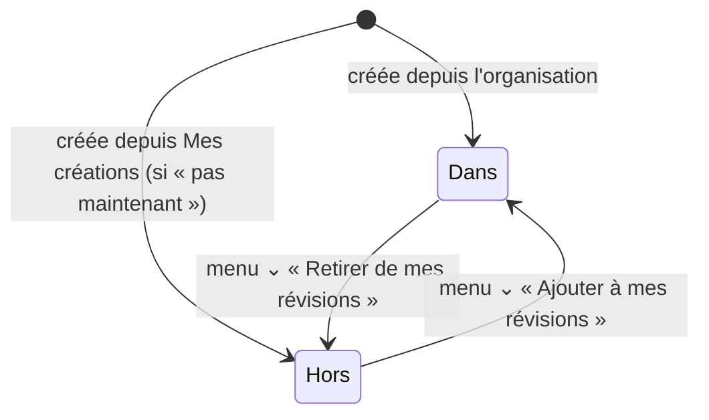

# darwin — spécification fonctionnelle

> **Ce document est la référence de la logique de l'appli.** Il décrit ce
> que fait darwin, sans code. On le tient à jour à chaque changement.
>
> - **Vous** (propriétaire) : écrivez vos demandes dans la rubrique
>   [Demandes](#9-demandes), avec vos mots. Vous pouvez aussi modifier
>   directement n'importe quelle règle : la modification vaut demande.
> - **Claude** : lit ce document avant chaque modification de l'appli,
>   signale toute contradiction avant de coder, puis met à jour les règles,
>   les écrans et le [journal des changements](#10-journal-des-changements)
>   dans la même branche que le code.
>
> Si l'appli et ce document ne disent pas la même chose, c'est soit un
> bug, soit une décision à prendre (rubrique [Questions
> ouvertes](#8-questions-ouvertes)).

**Version de l'appli décrite : v252** — première rédaction le 2 novembre 2026,
à partir du code.

## Sommaire

1. [Vue d'ensemble](#1-vue-densemble)
2. [Les concepts](#2-les-concepts)
3. [Comptes et usages](#3-comptes-et-usages)
4. [L'algorithme de révision](#4-lalgorithme-de-révision)
5. [Boîtes, dossiers et organisation](#5-boîtes-dossiers-et-organisation)
6. [Classes](#6-classes)
7. [Librairie et abonnements](#7-librairie-et-abonnements)
8. [Questions ouvertes](#8-questions-ouvertes)
9. [Demandes](#9-demandes)
10. [Journal des changements](#10-journal-des-changements)
11. [Annexe : les écrans](#11-annexe--les-écrans)
12. [Annexe : réglages de Darwin Admin](#12-annexe--réglages-de-darwin-admin)

---

## 1. Vue d'ensemble

**darwin** est une appli de révision par fiches question / réponse. Elle
décide elle-même **quand** reposer chaque fiche, selon les réponses
données et les échéances (contrôles, examens) notées dans l'agenda.

| Pour qui | Ce qu'il fait |
|---|---|
| **Élève** | Crée ses boîtes de fiches, révise, prend des boîtes dans la Librairie, rejoint les classes de ses enseignants. |
| **Enseignant** | Crée des classes, y partage des boîtes et des échéances, échange avec ses élèves. |
| **Administrateur** (darwin) | Règle l'appli depuis **Darwin Admin**, gère la Librairie, les abonnements, les établissements. |

L'appli s'installe sur un téléphone ou un ordinateur depuis le navigateur.
Elle fonctionne **hors connexion** : les changements partent vers le
serveur dès que le réseau revient. Une connexion à un compte est
**obligatoire** pour l'utiliser.

---

## 2. Les concepts

| Mot | Définition |
|---|---|
| **Compte** | Une adresse email + mot de passe. Toutes les données personnelles (boîtes, fiches, progression, agenda) appartiennent au compte et se retrouvent sur tous ses appareils. |
| **Usage** | « Élève » et/ou « Enseignant », choisis dans Mon compte. |
| **Compte élève / compte enseignant** | L'environnement utilisé, quand le compte a les deux usages (voir §3.2). |
| **Fiche** | Une question, une réponse ; en option : un complément (« en savoir plus »), 3 réponses fausses (mode QCM), un lien « Pour aller plus loin ». |
| **Boîte** | Un ensemble de fiches. Trois types, voir §5.1 : **à moi**, **de classe**, **de la Librairie**. |
| **Dossier** | Range des boîtes et d'autres dossiers, dans l'organisation. |
| **Dans / hors de mes révisions** | État d'une boîte : l'algorithme s'applique à ses fiches, ou non (la progression est gardée). Voir §5.2. |
| **Échéance (évènement)** | Une date dans l'agenda (contrôle, examen…), reliée à des boîtes. Elle fait passer ces boîtes en **mode sprint** (§4.3). |
| **Classe** | Un groupe créé par un enseignant, rejoint par des élèves avec un code. |
| **Librairie** | Le catalogue de boîtes publiées, accessible avec un abonnement (ou quelques boîtes gratuites). |
| **Collection** | Une boîte publiée dans la Librairie (c'est le mot utilisé dans le code). |
| **Signalement** | Un message envoyé à l'auteur d'une fiche pour lui signaler une erreur. |

---

## 3. Comptes et usages

### 3.1 Création du compte et connexion

À l'inscription, on donne : email, mot de passe, prénom, nom, date de
naissance, usages (élève et/ou enseignant, au moins un), niveau scolaire
(facultatif), et on accepte les conditions d'utilisation et la politique
de confidentialité.

- **Connexion obligatoire** : sans compte connecté, seule la page Mon
  compte est accessible.
- **Mot de passe oublié** : un email permet d'en choisir un nouveau.
- **Moins de 15 ans** : l'email d'un parent est demandé ; le parent reçoit
  un email pour donner son accord. En attendant, le compte est
  **limité** : on peut créer ses fiches et réviser, mais pas :
  rejoindre ou créer une classe, écrire dans une messagerie, signaler une
  fiche à son auteur, s'abonner, gérer un établissement. La limite se lève
  à l'accord du parent, ou automatiquement le jour des 15 ans.
- **Suppression du compte** (Mon compte) : tout est effacé définitivement
  (boîtes, fiches, progression, agenda, messages, boîtes publiées, classes
  de l'enseignant).

### 3.2 Compte élève / compte enseignant

| Usages cochés | À l'ouverture de l'appli | Environnement |
|---|---|---|
| Élève seulement | Accueil | Élève |
| Enseignant seulement | Accueil | Enseignant |
| Les deux | Page « Avec quel compte veux-tu continuer ? » (deux boutons ronds), puis accueil | Celui choisi |
| Aucun (anciens comptes « usage personnel ») | Accueil, avec un bandeau qui demande de choisir | Élève |

- Le choix entre les deux comptes est proposé **à chaque ouverture** de
  l'appli ; le dernier choix est mémorisé sur l'appareil.
- **Repère visuel** (seulement avec les deux usages) : pastille
  « ÉLÈVE » (bleu) ou « ENSEIGNANT » (orange) dans la barre du haut, et
  liseré de la même couleur en haut de l'écran.
- **Changer de compte** : toucher la pastille, **sur l'accueil
  uniquement**. Ailleurs, un message rappelle de passer par l'accueil.

**Ce qui change selon le compte utilisé (v250) :**

| | Compte élève | Compte enseignant |
|---|---|---|
| Bouton d'accueil « Mes classes » | Classes rejointes ; « Rejoindre une classe » s'il n'y en a aucune | Classes créées ; « Créer une classe » s'il n'y en a aucune |
| Organisation des boîtes | Dossier « Mes classes » en tête : boîtes des classes rejointes | Dossier « Mes classes » en tête : classes animées et leurs boîtes partagées |
| Agenda, Librairie, fiches, statistiques | Identiques | Identiques |

Les autres différences entre les deux environnements sont **à définir**
(voir §8).

---

## 4. L'algorithme de révision

> L'algorithme (« v2 », validé le 7 octobre) compte en **minutes** et
> tient compte des échéances de l'agenda.
>
> ✅ **Vérifié par des tests automatiques** (v252) : chaque règle de cette
> section a son test, lancé par GitHub à chaque modification du code. Si
> une règle change ici, son test change avec elle.

### 4.1 Les 4 réponses

Après avoir vu la réponse, on note la fiche :

| Bouton | Note | Sens |
|---|---|---|
| Je ne sais pas | 0 | Raté |
| Vague idée | 1 | Partiellement su |
| Je sais | 2 | Su |
| Parfaitement | 3 | Su sans effort |

Sous chaque bouton, l'appli affiche dans combien de temps la fiche
reviendra si on choisit cette note.

Chaque fiche retient : sa **dernière note**, la date de sa **dernière
interrogation**, son **dernier délai** (DD) et sa **prochaine date**.

### 4.2 Mode « fond » (pas d'échéance à venir)

Le nouveau délai se calcule ainsi :

> **nouveau délai = (DD − TE) + TE × coefficient**, puis ramené entre un
> **plancher** et un **plafond**.
>
> DD = dernier délai appliqué ; TE = temps écoulé depuis la dernière
> interrogation.

Autrement dit : si on se souvient bien après longtemps, le délai grandit
d'autant plus.

**Valeurs par défaut** (réglables dans Darwin Admin) :

| Note | Coefficient | Plancher | Plafond | En pratique |
|---|---|---|---|---|
| 0 — Je ne sais pas | 0 | 3 jours | 3 jours | toujours **3 jours** |
| 1 — Vague idée | 0 | 1 jour | 1 jour | toujours **1 jour** |
| 2 — Je sais | 2 | 3 jours | 30 jours | entre 3 et 30 jours |
| 3 — Parfaitement | 3 | 5 jours | 120 jours | entre 5 et 120 jours |

⚠️ « Je ne sais pas » repousse plus loin que « Vague idée » : voir la
question Q1 au §8.

### 4.3 Mode « sprint » (échéance à venir)

Une boîte passe en sprint dès qu'une **échéance à venir** de l'agenda la
concerne (directement, ou via un dossier relié à l'échéance).

- Au passage en sprint, toutes ses fiches deviennent **à revoir tout de
  suite**, et l'appli mémorise leur délai d'avant.
- Pendant le sprint, le délai est le plus court entre :
  - le délai du mode fond ;
  - **D − D / coefficient sprint**, où D = temps restant jusqu'à **8 h le
    jour de l'échéance** la plus proche.
- **Le jour même** de l'échéance : 30 minutes.
- Coefficients sprint par défaut : 1,03 / 1,05 / 2 / 3 (notes 0 à 3).
  Plus le coefficient est grand, plus la fiche revient tard avant
  l'échéance.
- **Une nouvelle échéance plus proche** remet les fiches à revoir tout de
  suite.
- **Fin du sprint** (plus aucune échéance à venir) : retour au mode fond.
  Prochaine interrogation = lendemain de la dernière échéance + le délai
  d'avant le sprint (ou, à défaut, le plancher de la dernière note).

### 4.4 La séance de révision

Une séance continue tant qu'on répond. Ordre de passage :

1. les fiches **dues** (la plus en retard d'abord) ;
2. les fiches notées 0 ou 1 **pendant la séance**, jusqu'à ce qu'elles
   aient été revues deux fois ;
3. toutes les autres, par date prévue (on révise alors « en avance »).

- **Au moins 10 autres fiches** entre deux passages d'une même fiche (ou
  toutes les autres, s'il y en a moins).
- Quand les fiches dues sont vues et les fiches ratées revues deux fois,
  le robot **propose la boîte suivante** des révisions conseillées (sauf
  en « Révisions prioritaires »).
- **Annuler** la dernière note est possible juste après.
- **Fiche QCM** : si elle a 3 réponses fausses, elle se présente en QCM.
  Une fiche QCM repassée en mode normal puis ratée repasse en QCM.

### 4.5 Où se révise-t-on ? (page « Réviser »)

| Entrée | Ce qui est révisé |
|---|---|
| **Révisions prioritaires** | Les boîtes reliées aux échéances à venir, échéance la plus proche d'abord. On peut décocher des boîtes. |
| **Renforcer mes connaissances** | Les boîtes **sans** échéance, triées par **retard moyen** (le plus en retard d'abord). |
| **Sélection manuelle** | Une boîte, un dossier, ou une sélection de boîtes, au choix. |

Seules les boîtes **dans mes révisions** (§5.2) et **non verrouillées**
(§7.3) sont concernées. La pastille « n à revoir » (en haut) compte les
fiches dues aujourd'hui.

### 4.6 La jauge de progression

Barre à 4 couleurs (du gris au vert) : part des fiches de la boîte (ou du
dossier) selon leur **dernière note** (jamais notée = 0).

---

## 5. Boîtes, dossiers et organisation

### 5.1 Les types de boîtes

| Type | D'où elle vient | Picto | Fiches modifiables ? |
|---|---|---|---|
| **À moi** | Créée par l'utilisateur | Boîte avec un crayon | Oui |
| **De classe** | Partagée par un enseignant d'une classe rejointe | Pile de feuilles | Non (copie en lecture seule, mise à jour en direct quand l'enseignant la modifie) |
| **De la Librairie** | Prise dans la Librairie | Picto « partage » | Non (copie mise à jour depuis la Librairie). Une fiche erronée se **signale** à l'auteur. Un administrateur peut la corriger pour tous. |

Pictos des dossiers : dossier classique ; dossier de classe : deux
personnages.

### 5.2 Dans / hors de mes révisions

| | Dans mes révisions | Hors de mes révisions |
|---|---|---|
| L'algorithme s'applique | Oui | Non (progression gardée) |
| Proposée dans Réviser, Révisions prioritaires, Renforcer | Oui | Non |
| Visible dans l'organisation | Oui, picto flèches en cercle **vertes** | Oui, picto flèches **barrées grises** (ou grisée, selon l'affichage choisi) |

Cas particuliers :

- **Boîte de classe** : toujours dans mes révisions, pas de choix.
- **Boîte de la Librairie prise avec l'offre gratuite** : la retirer
  **libère** une place gratuite mais **efface sa progression** (la boîte
  disparaît).
- **Boîte de la Librairie** : la remettre dans mes révisions demande un
  accès à la Librairie (abonnement ou place gratuite).

### 5.3 L'organisation des boîtes (page « Organisation »)

C'est la page centrale : **toutes** les boîtes de l'utilisateur y sont, à
leur place dans l'arborescence.

- **En tête : « Mes classes »**, rangé automatiquement, non modifiable :
  - compte élève : les classes rejointes et leurs boîtes ;
  - compte enseignant : les classes animées et l'arborescence de leurs
    boîtes partagées (lecture seule ; toucher une boîte ouvre la boîte
    d'origine de l'enseignant).
- Puis les dossiers et boîtes de l'utilisateur, par ordre alphabétique.
- **Boutons** : « + Nouvelle boîte » (bouton rond), « + Nouveau dossier »,
  champ **« Rechercher une boîte… »** (par nom, sans tenir compte des
  accents ; résultats en liste).
- **Affichages** : toute l'arborescence, ou les boîtes et branches hors
  révisions **grisées** ; nombre de fiches ou jauge à droite de chaque
  ligne.
- **Menu ⌄ d'une ligne** :

| Action | Dossier | Boîte à moi | Boîte de la Librairie | Boîte de classe | Dossier de classe |
|---|---|---|---|---|---|
| Renommer | ✅ | ✅ | ✅ | ❌ | ❌ |
| Déplacer | ✅ | ✅ | ✅ | ❌ | ❌ |
| Retirer de / Ajouter à mes révisions | — | ✅ | ✅ | ❌ | — |
| Supprimer | ✅ (s'il est vide) | ❌ (depuis la page de la boîte) | — | ❌ | ❌ |

- **Toucher une boîte** ouvre sa page (§5.4). Toucher un dossier le
  déplie ou le replie.
- **Créer une boîte** : nom + classification (catégorie → … → matière),
  puis choix du dossier ; elle entre dans mes révisions. Annuler le choix
  du dossier la laisse à la racine, hors de mes révisions.

### 5.4 La page d'une boîte

**Boîte à moi** (même page, qu'on vienne de l'organisation ou de Mes
créations) :

1. Titre : picto + nom de la boîte.
2. Bouton rond « + Ajouter une fiche ».
3. **Ma progression** (jauge) + bouton « Réviser » si la boîte est dans
   mes révisions.
4. **Pour aller plus loin** : lien vers un contenu externe (vidéo,
   cours…) + « Ajouter un lien » / « Modifier ».
5. Bloc **Fiches** (replié : nombre de fiches ; déplié : recherche par
   mot-clé, filtre des fiches signalées 🚩, liste des fiches avec leur
   menu ⌄ : éditer, déplacer, supprimer).
6. Bloc **Librairie** : « Publiée » / « Non publiée », puis la
   classification ou « Classification à définir ». Un seul bouton :
   **Classifier** → **Publier dans la Librairie** → **Voir dans la
   Librairie**.
7. Bouton « Supprimer la boîte » (définitif, avec ses fiches).

**Boîte de classe ou de la Librairie** : titre + picto, Ma progression
(+ Réviser), Pour aller plus loin (s'il y a un lien), bloc Fiches.

### 5.5 Mes créations (page amenée à disparaître)

Liste des boîtes créées par l'utilisateur, avec leur statut de
publication. Objectif : la supprimer quand l'organisation fera tout ce
qu'elle fait (voir §8, Q5).

### 5.6 Les fiches

- **Créer** : depuis une boîte (« + Ajouter une fiche ») — la fiche va
  dans cette boîte — ou depuis l'accueil, en choisissant la boîte.
- Après « Ajouter à la boîte », on reste sur la page pour enchaîner.
- **Éditer / déplacer / supprimer** : menu ⌄ de la fiche. Impossible pour
  une fiche de classe ou de la Librairie.
- **Signaler** (drapeau 🚩) : sur une fiche à moi, la marque « à
  corriger » ; sur une fiche de classe ou de la Librairie, ouvre un
  message à son auteur (voir §6.5).

### 5.7 Règles d'écriture des fiches

Ces règles valent pour **toutes** les fiches : celles des utilisateurs,
les boîtes toutes prêtes de darwin, et celles que Claude rédige.

1. **Fiche QCM : la question doit avoir du sens sans les propositions.**
   Une fiche QCM est d'abord posée avec ses 4 propositions, puis aussi en
   mode normal, **sans** elles. On n'écrit donc jamais « Laquelle de ces
   propositions est correcte ? », « Parmi les réponses suivantes… »,
   « Quel est l'intrus ? » (sans la liste), « Coche la bonne réponse »…
   - ❌ « Laquelle de ces villes est la capitale de l'Australie ? »
   - ✅ « Quelle est la capitale de l'Australie ? »
   - ✅ Accepté : les choix sont écrits **dans la question** elle-même
     (« Quel est l'intrus : pomme, poire, chou, kiwi ? »).
2. **Contrôles automatiques** de cette règle :
   - **dans l'appli**, en enregistrant une fiche QCM dont la question
     renvoie à des propositions, le robot prévient et propose de
     reformuler (on peut garder quand même) ; un rappel est écrit sous
     les cases des réponses fausses ;
   - **dans Darwin Admin** (Librairie → onglet « Questions QCM ») : liste
     des questions à revoir dans toute la Librairie en ligne et dans le
     fichier des boîtes toutes prêtes.

---

## 6. Classes

### 6.1 Côté enseignant

- **Créer une classe** : le robot demande un nom (modèle de nommage
  conseillé, avec l'année scolaire). Un **code d'invitation** est créé.
- **Page de la classe** :
  - code (copiable), renommer ;
  - bouton rond **Messagerie de la classe** (pastille : messages non lus) ;
  - bloc **Boîtes partagées** : arborescence propre à la classe,
    « + Dossier », « + Partager » (depuis mes boîtes ou depuis la
    Librairie), menu ⌄ pour ranger ;
  - bloc **Agenda de la classe** : échéances à venir, « + Ajouter » ;
  - bloc **Élèves** (nombre, puis la liste : prénom et nom, jamais
    l'email) ;
  - bouton « Supprimer la classe ».
- **Partager une boîte à moi** : une copie part dans la classe ; elle est
  **mise à jour chez les élèves** quand l'enseignant modifie sa boîte.
  Un message automatique l'annonce dans la messagerie.
- **Partager une boîte de la Librairie** dans une classe : soumis aux
  droits de son abonnement (§7.4).
- **Échéance de classe** : en l'ajoutant, l'enseignant relie des boîtes ;
  celles qui ne sont pas encore partagées le sont automatiquement.

### 6.2 Côté élève

- **Rejoindre une classe** avec le code donné par l'enseignant.
- Les boîtes partagées apparaissent **toutes seules** dans
  l'organisation, dossier « Mes classes », en lecture seule, toujours à
  jour.
- Les échéances de la classe arrivent dans **Mon agenda** et déclenchent
  le mode sprint sur les boîtes concernées.
- **Quitter la classe** retire ses boîtes de l'appareil.

### 6.3 Mes classes (page)

Bouton rond « Rejoindre une classe » (élève) ou « Créer une classe »
(enseignant), puis la liste des classes, chacune dans un bloc (nom, nombre
d'élèves, nombre d'échéances à venir). La dernière liste connue s'affiche
tout de suite, la liste à jour suit.

### 6.4 Agenda

- **Mon agenda** (accueil) : toutes les échéances de l'utilisateur, les
  siennes et celles de ses classes. Affichage en liste ou par mois.
- **Agenda de la classe** : seulement les échéances de la classe (bloc de
  la page de la classe).
- Une échéance : titre, date, boîtes et dossiers reliés, commentaire,
  classe éventuelle. Une échéance reçue d'un enseignant ne peut être ni
  modifiée ni supprimée par l'élève (sauf suppression une fois passée).

### 6.5 Messagerie et signalements

- **Messagerie** : une discussion par classe (enseignant + tous les
  élèves), en temps réel. Pastille de messages non lus sur « Mes
  classes » (accueil) et sur la page de la classe.
- **Signalements** : un élève signale une fiche erronée à son auteur ;
  l'auteur les retrouve dans « Signalements reçus », l'élève dans
  « Signalements émis ». Un bouton d'accueil « Signalements » n'apparaît
  que s'il y en a.

---

## 7. Librairie et abonnements

### 7.1 Consulter et prendre une boîte

- La Librairie se parcourt par **classification** (catégorie → cycle →
  niveau → année → spécialité → matière), lue dans le fichier Excel
  `data/taxonomie.xlsx`, avec filtres et recherche.
- Chaque boîte : nom, auteur (prénom et nom), description,
  classification, nombre de fiches, « pouces » des utilisateurs, aperçu
  des fiches.
- Sans accès, l'aperçu montre des réponses **coupées**.
- **« Ajouter à mes révisions »** : choix du dossier, puis une copie de la
  boîte arrive dans l'organisation ; elle suit les corrections faites dans
  la Librairie.

### 7.2 Publier une boîte

Deux chemins existent aujourd'hui :

| Depuis | Comment | Visible |
|---|---|---|
| **Une boîte à moi** (page de la boîte) | Classifier, puis « Publier dans la Librairie » : nom, classification, description | **Tout de suite** dans la Librairie |
| **Une boîte partagée avec une classe** (enseignant) | Proposition envoyée à darwin | Après relecture et publication depuis **Darwin Admin** |

- La boîte publiée est une **copie figée** au moment de la publication :
  si l'auteur modifie ensuite sa boîte, **la Librairie ne change pas**.
- Seul un **administrateur** peut corriger les fiches publiées (la
  correction s'applique à tous ceux qui ont pris la boîte).
- Une boîte ne peut être publiée qu'une fois.
- Voir la question Q3 (§8) : qui garde les droits sur une boîte publiée ?

### 7.3 Accès à la Librairie

| Situation | Accès |
|---|---|
| Abonnement **Super élève** actif ou à l'essai | Toute la Librairie |
| Abonnement **Super enseignant** actif | Toute la Librairie pour lui-même |
| Enseignant désigné par un établissement **Super école** | Idem |
| Administrateur | Tout |
| **Offre gratuite** | **2 boîtes** de la Librairie au choix (réglable) ; les remplacer efface la progression |
| Fin d'abonnement | Les boîtes prises hors offre gratuite sont **verrouillées** (cadenas) : visibles, mais ni révisables ni ouvrables |

⚙️ Tant que l'interrupteur « appliquer les abonnements » de Darwin Admin
est éteint, tout compte connecté a accès à la Librairie.

### 7.4 Les formules (d'après les CGV)

| Formule | Prix | Contenu |
|---|---|---|
| Super élève | 2 €/mois ou 20 €/an, 1er mois d'essai gratuit | Toute la Librairie |
| Super enseignant | 1 €/mois/classe (3 classes min.) ou 10 €/an/classe | Super élève pour lui + ses élèves (60 max par classe) révisent les boîtes de la Librairie qu'il partage dans ses classes |
| Super école | 50 €/an par enseignant désigné | Chaque enseignant désigné : Super enseignant pour 15 classes max |

- **Offre gratuite enseignant** : 1 classe, 2 boîtes de la Librairie dans
  cette classe (réglable).
- **Parrainage** : 1 mois offert au filleul, 2 mois au parrain (max 12 par
  an).
- Paiement par **Stripe** ; gestion de l'abonnement dans Mon compte.

⚠️ Le site vitrine n'affiche pas les mêmes noms ni prix : voir Q2.

### 7.5 Défi du jour

10 questions de culture générale par jour (2 de chaque niveau, de 1 à 5),
**les mêmes pour tout le monde**, sur le site et dans l'appli.

---

## 8. Questions ouvertes

> Décisions à prendre ou incohérences repérées. Répondez directement
> sous chaque question ; Claude reportera la réponse dans les règles.

**Q1 — « Je ne sais pas » repousse à 3 jours, « Vague idée » à 1 jour.**
Avec les réglages par défaut, une fiche ratée revient plus tard qu'une
fiche à moitié sue (elle revient quand même deux fois dans la séance en
cours). C'est voulu ? Les valeurs réellement en ligne sont peut-être
différentes (réglées dans Darwin Admin).
> Réponse : oui, pour l'instant c'est voulu. L'idée c'est que quand on commence à avoir une vague idée, ça vaut le coup de renforcer toute de suite. Et pour éviter d'avoir trop de fiches qui reviennent au quotidien, les fiches "je ne sais pas" ont été réglées à un plus long terme (tant qu'il n'y a pas d'échéance, rien ne presse)

**Q2 — Prix et noms des formules différents entre le site et les CGV.**
Site : « Individuel » et Super école à 5 €/mois/enseignant. CGV : « Super
élève » et Super école à 50 €/an/enseignant. Mis de côté pour l'instant
(les offres vont évoluer).
> Réponse : c'est les prix et noms de CGV qui sont bons pour l'instant.

**Q3 — Droits sur une boîte publiée dans la Librairie.**
Aujourd'hui : publication immédiate, copie figée, l'auteur ne peut plus la
mettre à jour, seul darwin peut corriger. Proposition de Claude : publier =
proposer (relecture par darwin) ; ensuite l'auteur propose ses
modifications, darwin garde le dernier mot ; l'auteur ne supprime pas, il
demande le retrait ; une phrase dans les CGU.
> Réponse : d'accord pour que Publier = proposer avec relecture par darwin. Pour la gestion des modifications et suppression, je ne sais pas encore trop ; fais ce que tu propose mais laisse ce sujet en suspend quelquepart

**Q4 — Deux chemins de publication différents** (immédiat pour une boîte à
moi, relecture pour une boîte de classe). Faut-il les unifier ? (lié à Q3)
> Réponse : oui

**Q5 — Suppression de « Mes créations ».** Prérequis restants : décider où
mène le hub « Mes fiches » (directement l'organisation ?), et vérifier que
rien ne manque à l'organisation.
> Réponse : peux-tu vérifier qu'on se passer de la page "mes créations" ? ensuite le bouton "Mes fiches" mènera directement à la page "Organisation des boites de révision"

**Q6 — Autres différences entre compte élève et compte enseignant**
(agenda, Librairie, statistiques, accueil…).
> Réponse : la page "Mon agenda" reportera tous les évènements concernant le profil en cours (élève ou enseignant). Sur la page "organisation des boites de révisions", seules les classes du profil en cours apparaitront, par contre tous les autres dossiers et boites seront communs aux deux profils ; avec le profil enseignants les notions "dans mes révisions" et hors de mes révisions" disparaissent ; d'ailleurs on va supprimer tout ce qui est en rapport avec les révisions dans le profil enseignant ("désactivation" du bouton "réviser" de l'accueil : griser le bouton et afficher un message quand on clique dessus)

**Q7 — Modifier la classification d'une boîte déjà classée** : la page de
la boîte n'a plus de bouton pour ça (seulement « Publier dans la
Librairie »). Faut-il un moyen de la modifier ?
> Réponse : oui

**Q8 — Avant l'ouverture au public : une adresse de test.**
Aujourd'hui, fusionner une branche publie la version pour tout le monde,
sur la même base de données. Avant le lancement, mettre en place une
copie de l'appli (avec sa propre base) pour essayer chaque version avant
sa mise en ligne. Rappelé par le bilan de lancement (`tools/lancement.py`).
> Réponse : d'accord pour attendre le lancement (3 nov. 2026).

---

## 9. Demandes

> Écrivez ici ce que vous voulez changer, avec vos mots. Une demande par
> puce. Claude les réalise, puis les déplace dans le journal des
> changements.
>
> Modèle : `- [ ] (date) Ce que je veux…`

- [ ] 

---

## 10. Journal des changements

| Version | Date | Changements |
|---|---|---|
| v252 | 3 nov. 2026 | Tests automatiques de l'algorithme de révision (§4) et du repérage des questions QCM (§5.7), lancés par GitHub à chaque modification. Aucun changement visible dans l'appli. |
| v251 | 3 nov. 2026 | Règle d'écriture des fiches QCM (§5.7) : avertissement dans l'appli à l'enregistrement, rappel sous les réponses fausses, onglet « Questions QCM » dans Darwin Admin (vérification de la Librairie et du fichier des boîtes toutes prêtes). Vérification du fichier des boîtes toutes prêtes du 22 octobre (1 176 boîtes, 100 fiches QCM) : aucune question à corriger. |
| v250 | 2 nov. 2026 | Page d'une boîte : Ma progression et Pour aller plus loin hors des blocs, bloc Librairie (Classifier → Publier), plus de bloc Mes révisions. Mes classes plus rapide, en blocs. Choix élève/enseignant immédiat. Page de classe : messagerie en bouton rond, agenda en liste. « Mon agenda ». |
| v249 | 2 nov. 2026 | Page de boîte unique pour ses boîtes. Classes de l'enseignant en tête de l'organisation. Recherche par nom. |
| v248 | 2 nov. 2026 | Organisation : toutes les boîtes, états dans/hors révisions avec pictos, + Nouvelle boîte, affichage grisé. Blocs repliables (boîte, classe). Rejoindre/Créer une classe sur l'accueil. |
| v247 | 1 nov. 2026 | Comptes élève/enseignant. Suppression de la page École. Mes classes et Agenda sur l'accueil. Agenda et messagerie de classe. |
| v246 | 31 oct. 2026 | Aide en touchant le robot. Boutons plus petits. Fiches affichées dans la page d'une boîte. |
| ≤ v245 | — | Historique antérieur (non détaillé ici). |

---

## 11. Annexe : les écrans

| Écran | Accès | Contenu |
|---|---|---|
| **Choix du compte** | Ouverture (deux usages) | Mon compte élève / Mon compte enseignant |
| **Accueil** | — | Boutons ronds : Réviser, Défi du jour, Mes fiches, Mes classes (ou Rejoindre / Créer une classe), Mon agenda, Librairie, Statistiques, Réglages, Mon compte, Signalements (s'il y en a). Bandeau défilant d'alertes. |
| **Réviser** | Accueil | Révisions prioritaires, Renforcer mes connaissances, Sélection manuelle |
| **Séance de révision** | Réviser | Fiche, 4 boutons de note, jauge, mini-histogramme des échéances |
| **Mes fiches** | Accueil | Organiser mes fiches, Créer mes fiches (Mes créations) |
| **Organisation** | Mes fiches | §5.3 |
| **Page d'une boîte** | Organisation, Mes créations | §5.4 |
| **Nouvelle fiche / Modifier la fiche** | Page d'une boîte, accueil | Question, réponse, complément, QCM, lien |
| **Mes classes** | Accueil | §6.3 |
| **Page d'une classe** | Mes classes | §6.1 |
| **Messagerie de la classe** | Page d'une classe | Discussion |
| **Mon agenda / Agenda de la classe** | Accueil / page d'une classe | §6.4 |
| **Librairie** | Accueil | §7.1 |
| **Statistiques** | Accueil | Chiffres de révision |
| **Réglages** | Accueil | Préférences de l'appareil, mises à jour (numéro de version) |
| **Mon compte** | Accueil | Profil, usages, niveau, abonnement, déconnexion, suppression |
| **Défi du jour** | Accueil | §7.5 |

**Partout** : robot en haut des pages — le toucher affiche l'aide de la
page ; bouton « ? » pour l'aide sur un élément précis ; bouton mode nuit ;
état de la synchronisation ; pastille « n à revoir ».

---

## 12. Annexe : réglages de Darwin Admin

Darwin Admin (`admin/`) permet de régler, pour tous les utilisateurs :

- l'**algorithme** (coefficients, planchers, plafonds — §4) ;
- les **abonnements** : appliquer ou non, durée de l'essai, offre gratuite
  (boîtes, classes), parrainage, ouverture du paiement ;
- l'**apparence** : couleurs, pictos, disposition des boutons de
  l'accueil, textes d'aide du robot ;
- la **Librairie** : propositions des enseignants, corrections,
  modération, vérification des questions QCM (§5.7) ;
- les **établissements** (Super école) : devis, factures, enseignants
  désignés.
